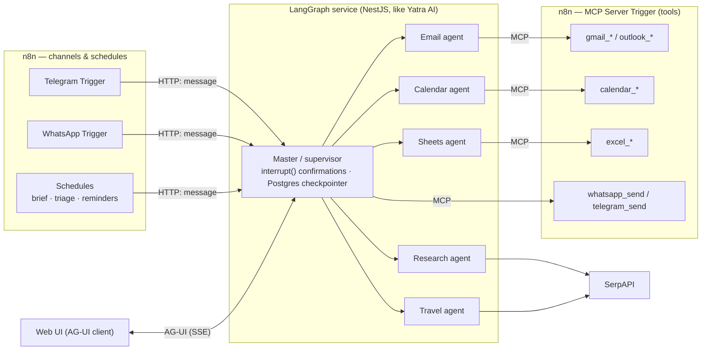
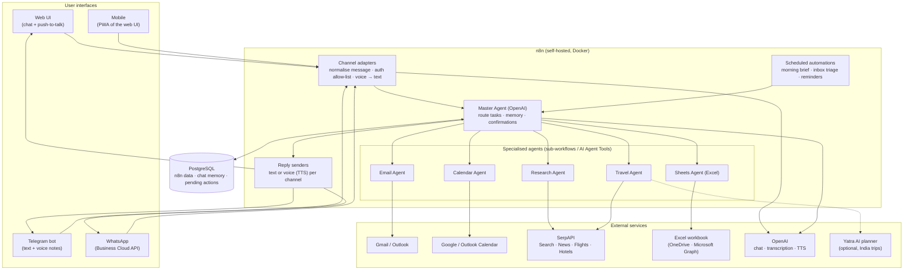
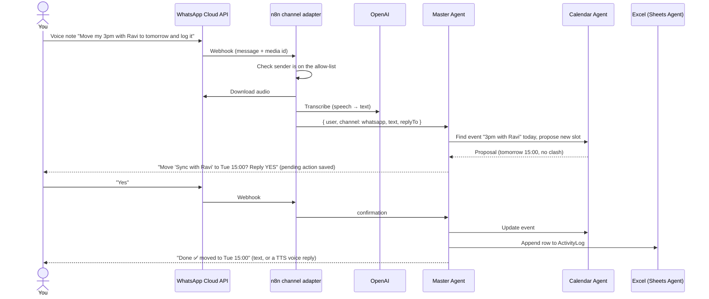

# SwarmAI — Multi-Agent Personal Assistant: Plan

Status: **built — hybrid (option C)**; see [README.md](README.md) to run it · LLM: **OpenAI** (replaces Gemini from the original HLD)

SwarmAI is a personal assistant made of specialised AI agents (email, calendar, research, travel, spreadsheet) coordinated
by a master agent. You reach it from a **web UI, Telegram, WhatsApp and voice**, and it keeps structured records in an
**Excel workbook**. Additions to the original HLD: **WhatsApp channel**, **Excel integration (+ a Sheets agent)**,
**OpenAI instead of Gemini**, **confirmation before risky actions**, and **scheduled automations**.

---

## 0. Decisions (approved)

| Topic | Decision |
|---|---|
| Architecture | **Hybrid (C):** LangGraph "brain" service (NestJS) runs all agents; **n8n** runs channels (Telegram, WhatsApp), the scheduler and outbound delivery, and exposes channel tools over **MCP** |
| Email & calendar | **Gmail + Google Calendar** |
| Spreadsheet | **Google Sheets** (not Excel): one workbook per user with tabs Tasks, Expenses, Contacts, TravelLog, EmailDigest, ActivityLog |
| Users | **Several users** — sign-up/login, per-user Google connection, per-user memory, threads and workbook |
| Web UI | **Custom Next.js PWA** with push-to-talk, streaming over AG-UI |
| Hosting | Local Docker (Postgres + n8n) while learning; tunnel/VPS for public webhooks |

**What "several users" changes:** n8n stores one credential per node, so it cannot act on each user's own Gmail.
Each user connects Google to the **brain** (OAuth, refresh token encrypted at rest), and the brain calls Gmail,
Calendar and Sheets directly. n8n serves everyone through **one** Telegram bot and **one** WhatsApp number; users link
those chats to their account with a one-time code. This also keeps n8n within its free licence, because n8n never
holds end-users' credentials.

### 0.1 Agents (10)
| Agent | Does | Side effects needing confirmation |
|---|---|---|
| Email | Search, read, summarise, draft, reply, send, archive (Gmail) | send, reply, archive |
| Calendar | Agenda, free slots, create / move / cancel events (Google Calendar) | create, update, delete |
| Research | Web + news search (SerpAPI, keyless fallbacks), read a URL, cite sources | — |
| Travel | Flights & hotels (SerpAPI), weather + IMD warnings, India trip plans via Yatra AI | — (never books) |
| Records | Tasks, contacts, travel log in Postgres, mirrored to the user's Google Sheet | delete |
| Finance | Log expenses, read receipt photos (vision), monthly summaries | logging from a receipt photo |
| Notes & Memory | Save/search notes (semantic, pgvector), remember personal facts used in every answer | — |
| Reminders | Time-based reminders delivered on Telegram/WhatsApp/web | — |
| Shopping | Product price search, price watches with target price | — |
| Documents | Summarise / extract from images and text files sent in chat | — |

### 0.2 Automated flows (n8n scheduler → brain → delivery)
| Flow | When | What you get |
|---|---|---|
| Reminders | Every minute | Due reminders |
| Morning brief | User's chosen time (default 08:00) | Agenda, important unread mail, tasks due, weather + IMD alerts |
| Inbox triage | Every 30 min | Urgent-mail alerts; EmailDigest rows; action items → Tasks |
| Meeting prep | ~30 min before an event | Who's attending, recent emails with them, links |
| Follow-up nudges | Daily 18:00 | Sent emails with no reply after 3 days |
| Price watch | Daily 09:00 | Alerts when a watched product drops below target |
| Weekly review | Sunday 19:00 | Spend by category, tasks done/pending, next week's calendar load |

---

## 1. Is n8n the right platform?

**Verdict: yes, n8n is a good fit for this project — use it as the core, self-hosted with Docker.**
This assistant is mostly *integration work* (OAuth to Gmail/Calendar/Microsoft, Telegram and WhatsApp webhooks, file
downloads for voice notes, spreadsheet I/O). n8n ships all of those as nodes with managed credentials, and it now has
first-class AI agent features, so most of the plumbing we hand-wrote in the travel planner comes for free.

### 1.1 What n8n gives this project
| Need | n8n feature |
|---|---|
| Master agent + specialised agents | **AI Agent** node; **AI Agent Tool** node lets one agent supervise sub-agents, each with its own prompt and tools; or sub-workflows exposed as tools |
| Memory / context | Chat memory nodes (Postgres-backed) keyed by session |
| Email | Gmail and Microsoft Outlook nodes (read, search, label, draft, send, reply) |
| Calendar | Google Calendar and Outlook Calendar nodes (list, create, update, delete, availability) |
| Research & travel | SerpAPI tool node; HTTP Request node for any SerpAPI engine (Google, News, Flights, Hotels) |
| Telegram | Telegram Trigger + Telegram node (text, voice download, send audio) |
| WhatsApp | **WhatsApp Trigger** + **WhatsApp Business Cloud** node (text, voice notes, media upload/download) |
| Excel | **Microsoft Excel 365** node (append/lookup/list rows in tables, worksheets) for OneDrive workbooks; HTTP node + Graph API for anything else |
| Voice | OpenAI node: audio transcription (speech→text) and text-to-speech |
| Web UI | Chat Trigger (hosted chat page / embeddable widget) or a Webhook for a custom UI |
| Tools beyond nodes | MCP Client Tool (connect agents to any MCP server); Code nodes (JS/Python) |
| Ops | Credentials vault, execution history, error workflows, scheduled triggers, Docker images |

### 1.2 Where n8n is weaker (and how we handle it)
| Weakness | Mitigation in this plan |
|---|---|
| Complex orchestration (parallel fan-out, custom state machines) is harder than in code (e.g. LangGraph) | Keep the master agent simple (tool-calling router). Heavy logic can live in a Code node or an external service called over HTTP. |
| Testing and version control of visual workflows | Export workflows as JSON into git; keep a test-prompt suite and use n8n's evaluation features / a test workflow before each change. |
| Licence (Sustainable Use License, not OSI open source) | Free for personal/internal use, which this project is. Turning it into a product where n8n connects to *other people's* accounts needs an n8n commercial (Embed) licence — or a switch to an MIT alternative (Activepieces) or code. |
| One WhatsApp webhook per Meta app | Separate Meta apps (or numbers) for dev and prod. |
| Debugging long agent chains | n8n execution logs + an "activity log" sheet in Excel + OpenAI usage tracking. |

### 1.3 Alternatives considered
| Option | Strengths | Why not the core here |
|---|---|---|
| **n8n** (chosen) | 400+ integrations incl. WhatsApp, Telegram, Gmail, Outlook, Excel, SerpAPI; AI Agent + sub-agents; MCP; self-host | — |
| **Activepieces** (MIT) | Truly open-source licence, agent layer with MCP, Zapier-like UX | Smaller catalogue (~280 pieces), smaller community; pick it only if licence freedom for a SaaS matters |
| **Dify** | Best-in-class for LLM apps: prompt IDE, RAG, LLMOps | Weak at mailbox/calendar/WhatsApp automation; would still need n8n or code for integrations |
| **Flowise / Langflow** | Visual LangChain agent prototyping | Few business integrations; not built for webhooks/schedules |
| **Code: LangGraph / OpenAI Agents SDK + NestJS** (like our travel planner) | Full control, parallel agents, AG-UI streaming, unit tests | Must hand-build OAuth (Google + Microsoft), Telegram/WhatsApp webhooks, media handling, scheduling — weeks of plumbing for this scope |
| **Zapier / Make** | Easiest SaaS | Closed, per-task pricing, limited agent control, no self-hosting |

**Recommendation:** n8n as the platform. Keep the door open for a *hybrid* later: if a capability needs real code
(e.g. advanced planning), run it as a small service and call it from n8n over HTTP or MCP — for example, our existing
**Yatra AI travel planner API** can become a tool of the Travel Agent for trips within India.

### 1.4 What about LangGraph tools and agents?

LangGraph (which we used for Yatra AI) can play the agent role here too. Current JS packages: `@langchain/langgraph`
1.5, `@langchain/langgraph-supervisor` (`createSupervisor`), `@langchain/langgraph-swarm` (`createSwarm`, handoff
tools), `langchain` 1.5 (`createAgent`), and `@langchain/mcp-adapters` (use MCP servers as LangChain tools).

**Multi-agent patterns LangGraph offers**

| Pattern | How it works | Fit for SwarmAI |
|---|---|---|
| **Supervisor — agents as tools** | Master agent calls each specialist as a tool and decides what context it sees (LangChain's current recommendation over the `createSupervisor` prebuilt) | ✅ Best: one place to enforce confirmations, memory and the allow-list |
| Supervisor prebuilt (`createSupervisor`) | Same idea, packaged | OK, less control over each agent's context |
| **Swarm** (`createSwarm`) | Agents hand off control to each other directly; the last active agent continues the conversation | Interesting for chained tasks (Travel → Calendar → Email), but harder to guarantee a confirmation step before every side effect |
| Custom `StateGraph` | Hand-built graph (like Yatra AI: supervisor router + parallel fan-out) | When tasks need parallel agents or strict ordering |

**What LangGraph adds that n8n agents don't do as well**
| Capability | LangGraph | n8n AI Agent |
|---|---|---|
| Parallel specialists | Native fan-out | Sub-agents run one after another |
| Human approval | `interrupt()` + resume — proven in Yatra AI's booking approval | Build it yourself (pending-action table) or per-node "send and wait" |
| Durable memory | Postgres checkpointer per thread + long-term store | Chat memory node |
| Cancellation | AbortSignal through every node (Yatra AI) | Stop the execution |
| Live web UI | AG-UI streaming (Yatra AI) | Chat widget / webhook |
| Testing | Unit + contract tests in code, git diffs | Exported JSON, test workflows |
| Integrations | You write them (Google, Microsoft Graph, WhatsApp, Telegram, OAuth refresh) | 400+ nodes with managed credentials |
| Speed to first version | Slower | Faster |

**Three ways to build SwarmAI**
| | A. n8n only | B. LangGraph only (code) | C. Hybrid: LangGraph brain + n8n hands |
|---|---|---|---|
| Agents | n8n AI Agent + AI Agent Tool | LangGraph supervisor + specialists | LangGraph supervisor + specialists |
| Tools (Gmail, Calendar, Excel, WhatsApp send) | n8n nodes | Hand-written API clients | **n8n workflows exposed via the MCP Server Trigger**, loaded with `@langchain/mcp-adapters` |
| Research / travel tools | SerpAPI node | Code (SerpAPI HTTP) | Code (SerpAPI HTTP) |
| Telegram / WhatsApp / schedules | n8n triggers | Hand-written webhooks + cron | n8n triggers → call the LangGraph service |
| Web UI | n8n chat widget | AG-UI (reuse Yatra AI) | AG-UI (reuse Yatra AI) |
| Effort | Lowest | Highest | Medium |
| Matches the brief ("built on n8n") | Yes | No | Yes (n8n is still the integration platform) |



**Recommendation:** go with **C (hybrid)** if you want production-grade agent behaviour and to reuse what already
works in Yatra AI (supervisor routing, `interrupt()` approvals, cancellation, Postgres checkpoints, AG-UI). n8n still
does what is painful in code: OAuth, WhatsApp/Telegram webhooks, voice-file handling, Excel, schedules. Choose **A**
if the goal is mainly to learn n8n end to end with the least moving parts; it can be upgraded to C later by moving the
master agent out of n8n and exposing the existing tool workflows through an MCP Server Trigger. **B** is not
recommended here: it rebuilds integrations that n8n already provides.

---

## 2. Architecture



### 2.1 One request, end to end (WhatsApp voice note)



### 2.2 n8n workflow map
| # | Workflow | Trigger | Purpose |
|---|---|---|---|
| WF-01 | Channel: Telegram | Telegram Trigger | Normalise text/voice → Master → reply (text or voice) |
| WF-02 | Channel: WhatsApp | WhatsApp Trigger | Same for WhatsApp (text, voice notes) |
| WF-03 | Channel: Web | Webhook / Chat Trigger | Web UI chat + push-to-talk audio upload |
| WF-10 | Master Agent | Execute Workflow | Router agent with memory, confirmation tool, calls agent tools |
| WF-20 | Email Agent | Called by master | Search/read/summarise, draft, send/reply (after confirmation), labels |
| WF-30 | Calendar Agent | Called by master | Agenda, free/busy, create/move/cancel (after confirmation) |
| WF-40 | Research Agent | Called by master | SerpAPI search + news, fetch pages, summarise with sources |
| WF-50 | Travel Agent | Called by master | SerpAPI Google Flights/Hotels, compare, optional Yatra AI for India |
| WF-60 | Sheets Agent | Called by master | Read/write Excel tables (expenses, tasks, contacts, travel log) |
| WF-70 | Morning brief | Schedule (e.g. 08:00) | Today's calendar + important unread mail + weather/news → preferred channel |
| WF-71 | Inbox triage | Schedule (every 15–30 min) | Classify new mail, flag urgent, log digest to Excel |
| WF-72 | Reminders | Schedule | Upcoming events / due tasks → Telegram/WhatsApp |
| WF-90 | Error handler | Error Trigger | Notify you on Telegram, log to Excel |

---

## 3. Agents

| Agent | Tools (n8n nodes) | Example requests | Needs confirmation |
|---|---|---|---|
| **Master** | Memory, pending-action store, the 5 agent tools | "What's my day like?", "Plan Goa next weekend and block my calendar" | Holds the YES/NO step for risky actions |
| **Email** | Gmail/Outlook: search, get, draft, send, reply, label | "Summarise unread mail from my manager", "Reply to Asha that Friday works" | Send / reply / delete |
| **Calendar** | Google/Outlook Calendar: list, availability, create, update, delete | "Find 30 min with Ravi this week", "Cancel tomorrow's gym" | Create / move / delete |
| **Research** | SerpAPI (Google, Google News), HTTP fetch, OpenAI summarise | "Compare 3 note-taking apps", "Latest on RBI repo rate" | — |
| **Travel** | SerpAPI Google Flights & Hotels, (optional) Yatra AI API | "Cheapest BLR→DEL flights Friday evening", "Hotels near Connaught Place under ₹6k" | Never books — gives options and links |
| **Sheets (Excel)** | Microsoft Excel 365: append, lookup, list rows | "Log ₹450 lunch", "Add task: renew passport by 30 Nov", "Travel spend this month?" | Deleting rows |

Design rules:
- **Master routes, specialists act.** Each specialist has a narrow prompt and only its own tools.
- **Confirmation for side effects.** Sending mail, changing calendars or deleting rows creates a *pending action*
  (stored in Postgres) and asks "Reply YES to confirm". This works the same on every channel.
- **Owner-only access.** An allow-list of your Telegram chat ID, WhatsApp number and web login; everyone else is ignored.
- **Audit trail.** Every action the assistant takes is appended to an `ActivityLog` table in Excel.

---

## 4. Excel integration

A single workbook in OneDrive, e.g. `SwarmAI.xlsx`, with one Excel *table* per sheet (the Excel 365 node works with tables):

| Table | Columns (draft) | Written by | Read by |
|---|---|---|---|
| `Tasks` | id, task, due, priority, status, source | You (chat), Email agent (action items) | Morning brief, Reminders |
| `Expenses` | date, amount (₹), category, note, channel | You ("log ₹450 lunch") | "How much did I spend on…" |
| `Contacts` | name, email, phone, notes | You / Email agent | Email & Calendar agents (resolve "Ravi") |
| `TravelLog` | trip, dates, flights/hotels chosen, est. cost, links | Travel agent | You |
| `EmailDigest` | date, from, subject, summary, urgency | Inbox triage | Morning brief |
| `ActivityLog` | timestamp, channel, request, agent, action, result | All agents | You (audit) |

Requirements: a Microsoft account (personal or work), an app registration in Microsoft Entra for OAuth
(`Files.ReadWrite` scope), and the workbook stored in OneDrive. If you prefer Google, the same design works with the
Google Sheets node.

---

## 5. Channels & voice

| Channel | How | Notes |
|---|---|---|
| **Web UI** | Start with n8n's Chat Trigger widget; upgrade to a small custom Next.js page (chat + push-to-talk mic) calling an n8n webhook | Installable as a **PWA** = the "mobile app" in the HLD |
| **Telegram** | BotFather token → Telegram Trigger | Free, no message limits that matter for one user; best channel for proactive messages (briefs, reminders) |
| **WhatsApp** | Meta developer app + WhatsApp Business Cloud API, a dedicated phone number (a test number works for development), webhook to n8n | Replies within 24 h of your last message are "service messages"; from 1 Oct 2026 Meta charges them but the first 1,000 per number per month are free. Proactive messages outside 24 h need approved templates (billed), so send the morning brief via Telegram or a template |
| **Voice** | Voice notes on Telegram/WhatsApp and push-to-talk on the web → download audio → OpenAI transcription → agent → optional OpenAI text-to-speech reply | Live two-way voice (OpenAI Realtime) is a later stretch goal |

All channels use the same normalised message shape:
`{ userId, channel, text | audioUrl, replyTo, messageId, timestamp }`.

---

## 6. Accounts & credentials needed

| Service | What you create | Used for | Cost |
|---|---|---|---|
| OpenAI | API key (already have) | All agents, transcription, TTS | Pay per use |
| Google Cloud | OAuth client (Gmail + Calendar scopes) | Email & Calendar agents (if Google) | Free |
| Microsoft Entra | App registration (Mail, Calendars, Files scopes) | Excel (and Outlook if Microsoft) | Free |
| Telegram | Bot via @BotFather | Telegram channel | Free |
| Meta for Developers | App + WhatsApp Business account + phone number | WhatsApp channel | Free tier, then per message |
| SerpAPI | API key | Research & travel search | Free tier with a small monthly search quota, then paid |
| Public HTTPS URL | Cloudflare Tunnel (or ngrok) for local; a domain on a VPS for always-on | Telegram/WhatsApp webhooks | Free / small VPS |

---

## 7. Deployment

```
swarm-ai/
├── docker-compose.yml     # n8n (+ queue mode later), PostgreSQL, Cloudflare Tunnel
├── .env.example           # N8N_ENCRYPTION_KEY, DB, public URL, timezone Asia/Kolkata …
├── workflows/             # exported n8n workflow JSON (version-controlled)
├── web/                   # optional custom web UI (Next.js PWA)
├── docs/                  # architecture, setup guides per integration, runbook
└── tests/                 # test prompts + expected behaviour per agent
```

- n8n with PostgreSQL (not SQLite) so chat memory and executions persist.
- Public HTTPS via Cloudflare Tunnel during development; a small VPS later for 24/7 availability (WhatsApp/Telegram
  webhooks need the server reachable).
- Back up the n8n encryption key — it protects all stored credentials.

---

## 8. Phases

| Phase | Deliverable | Done when |
|---|---|---|
| **0. Setup** | Docker Compose (n8n + Postgres + tunnel), credentials for OpenAI, Telegram, SerpAPI | n8n reachable over HTTPS; test webhook works |
| **1. Core assistant** | Telegram channel + Master Agent with memory + Research Agent | "Latest news on X" answered on Telegram with sources |
| **2. Email & Calendar** | Email + Calendar agents with the confirmation flow | Can summarise inbox, draft + send after YES, create/move events after YES |
| **3. Travel & Excel** | Travel Agent (SerpAPI Flights/Hotels), Sheets Agent, ActivityLog | Flight/hotel options returned; expenses/tasks logged and queried in Excel |
| **4. WhatsApp & voice** | WhatsApp channel; voice notes on Telegram/WhatsApp; TTS replies | Voice note → correct action → voice/text reply on both apps |
| **5. Web UI** | Chat widget → custom PWA with push-to-talk | Same assistant on web and phone home screen |
| **6. Automations & hardening** | Morning brief, inbox triage, reminders, error workflow, allow-list, workflow export to git, docs | Brief arrives daily; errors reach you on Telegram; README + setup guides complete |

---

## 9. Testing
- A **test-prompt suite** per agent (e.g. 10–15 requests each with expected tool calls/outcomes), run through a test
  workflow after every change.
- **Dry-run mode** for Email/Calendar during development (drafts only, a test calendar).
- Channel tests: text and voice on Telegram and WhatsApp; confirmation YES/NO; non-allow-listed sender is ignored.
- Cost check: OpenAI and SerpAPI usage per day from the ActivityLog.

---

## 10. Risks
| Risk | Impact | Mitigation |
|---|---|---|
| Agent sends a wrong email / deletes an event | High | Confirmation step for every side effect; dry-run mode; ActivityLog |
| Someone else messages the bot | High (mailbox access) | Strict allow-list per channel |
| WhatsApp setup (Meta verification, number, single webhook) | Medium | Start with Meta's test number; separate dev/prod apps |
| OAuth token expiry / scope errors | Medium | n8n credential refresh; error workflow alerts on Telegram |
| SerpAPI free quota exhausted | Low | Cache results; cap searches per request |
| n8n licence if this becomes a product for others | Low now | Personal use is fine; revisit (Embed licence / Activepieces / code) before commercialising |

---

## 11. Decisions needed from you
1. **Google or Microsoft for email and calendar?** Excel lives in Microsoft OneDrive, so an *all-Microsoft* setup
   (Outlook + Outlook Calendar + Excel) needs one login; *Gmail + Google Calendar + Excel* needs two. Or use Google
   Sheets instead of Excel.
2. **What should the Excel workbook track?** Proposed: Tasks, Expenses, Contacts, TravelLog, EmailDigest, ActivityLog.
3. **Just you, or several users?** (Changes auth, memory keys and the n8n licence question.)
4. **Web UI:** n8n's built-in chat widget (fast) or a custom Next.js PWA with push-to-talk (nicer, more work)?
5. **Hosting:** your Mac with a tunnel while learning, or a VPS for 24/7?
6. **Reuse Yatra AI** as the Travel Agent's tool for trips within India?
7. **Agent engine:** A (n8n agents only), or C (LangGraph agents + n8n integrations over MCP)? See §1.4.

---

### Sources
- n8n multi-agent (AI Agent Tool) and MCP: [n8n Review 2026](https://beginnersinai.org/n8n-review/), [Multi-agent solutions in n8n](https://hatchworks.com/blog/ai-agents/multi-agent-solutions-in-n8n/), [n8n as Agentic MCP Hub](https://www.infralovers.com/blog/2026-03-09-n8n-agentic-mcp-hub/)
- Licence: [Apache 2.0 vs fair-code](https://www.sim.ai/library/apache-2-0-vs-fair-code), [May my agency host n8n for customers?](https://nordflux.de/en/guides/may-my-agency-host-n8n-for-customers-fair-code-resale-gray-area-customer-access)
- n8n nodes: [WhatsApp Trigger docs](https://docs.n8n.io/integrations/trigger-nodes/n8n-nodes-base.whatsapptrigger/), [Microsoft Excel 365 node docs](https://docs.n8n.io/integrations/builtin/app-nodes/n8n-nodes-base.microsoftexcel/), [Telegram voice → Whisper workflow](https://growwstacks.com/workflows/transcribe-voice-messages-from-telegram-using-openai-whisper-1)
- LangGraph multi-agent: [Multi-agent prebuilts (JS)](https://docs.langchain.com/oss/javascript/multi-agent-prebuilts), [Custom multi-agent (JS)](https://docs.langchain.com/oss/javascript/multi-agent-custom), [@langchain/langgraph-swarm reference](https://reference.langchain.com/javascript/langchain-langgraph-swarm)
- n8n as an MCP server: [MCP Server Trigger docs](https://docs.n8n.io/integrations/builtin/core-nodes/n8n-nodes-langchain.mcptrigger/), [MCP Client Tool docs](https://docs.n8n.io/integrations/builtin/cluster-nodes/sub-nodes/n8n-nodes-langchain.toolmcp/)
- Alternatives: [Open-source AI agent platform comparison 2026](https://jimmysong.io/blog/open-source-ai-agent-workflow-comparison/), [n8n vs LangChain, Flowise, Dify, Activepieces](https://nordflux.de/en/insights/n8n-vs-langchain-flowise-dify-activepieces)
- WhatsApp pricing change (Oct 2026): [respond.io](https://respond.io/blog/whatsapp-pricing-change-2026.md)
