# SwarmAI — architecture, flows and libraries

This document explains **how a request moves through SwarmAI** (diagrams) and **which library or framework does what,
and why it was chosen**. For setup see [SETUP-INTEGRATIONS.md](SETUP-INTEGRATIONS.md); for what you can ask, see
[USER-GUIDE.md](USER-GUIDE.md).

Contents
1. [The big picture](#1-the-big-picture)
2. [Flow: a chat in the web app (with approval)](#2-flow-a-chat-in-the-web-app-with-approval)
3. [Flow: a Telegram / WhatsApp message (text, voice, photo)](#3-flow-a-telegram--whatsapp-message)
4. [Inside the brain: the LangGraph agent graph](#4-inside-the-brain-the-langgraph-agent-graph)
5. [Flow: scheduler, reminders and proactive messages](#5-flow-scheduler-reminders-and-proactive-messages)
6. [Flow: connecting Google](#6-flow-connecting-google)
7. [Flow: one-command setup](#7-flow-one-command-setup)
8. [Libraries and frameworks — what each one is used for](#8-libraries-and-frameworks)
9. [External services and APIs](#9-external-services-and-apis)
10. [Why this split (brain vs n8n)](#10-why-this-split-brain-vs-n8n)
11. [Platform: organisations, agent registry, knowledge base, customer desk](#11-platform-organisations-agent-registry-knowledge-base-customer-desk)

---

## 1. The big picture

SwarmAI has three running parts plus a database:

| Part | Technology | Job |
|---|---|---|
| **Web app** | Next.js PWA (:3200) | chat UI, push-to-talk, approval cards, dashboard, settings |
| **Brain** | NestJS + LangGraph (:4200) | all thinking: master agent, 10 specialist agents, tools, automations, data |
| **n8n** ("hands") | n8n workflows (:5678) | Telegram & WhatsApp in/out, the every-minute scheduler, error alerts, MCP "send" tools |
| **Database** | PostgreSQL 17 + pgvector (:5434) | users, conversations, agent checkpoints, tasks/expenses/notes, embeddings, outbox |

Technical version (Mermaid)

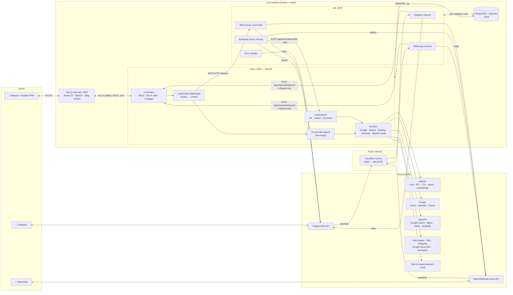

**Rule of thumb:** the brain *decides*, n8n *delivers*. n8n never calls an LLM and never holds a user's Google
credentials; the brain never talks to Telegram/WhatsApp directly (it asks n8n through MCP or the outbox).

---

## 2. Flow: a chat in the web app (with approval)

Example: *"Email Rahul that I'll send the deck Friday, and what's the weather in Pune tomorrow?"*

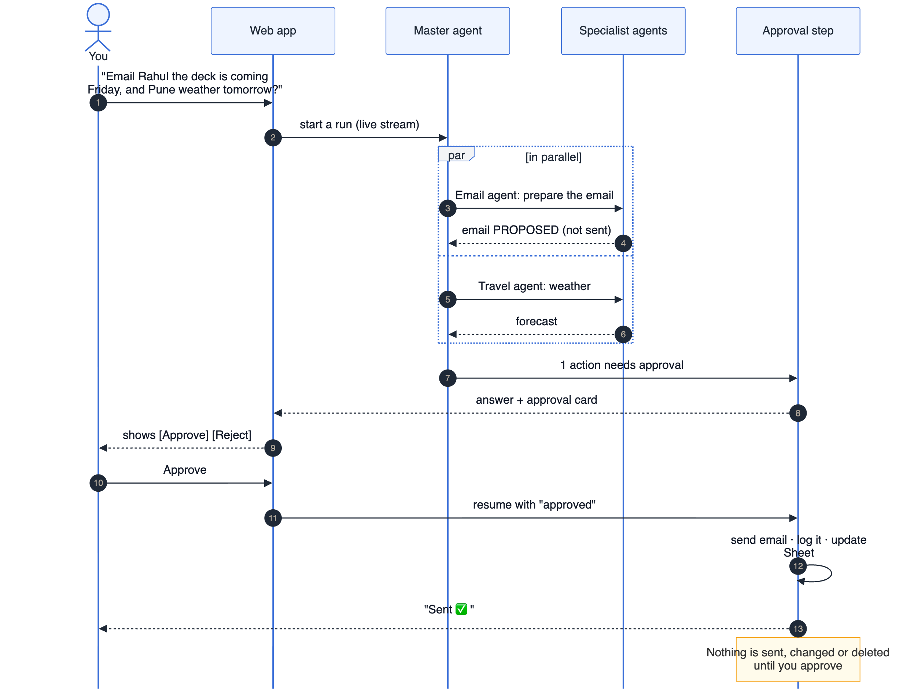

Technical version (Mermaid)

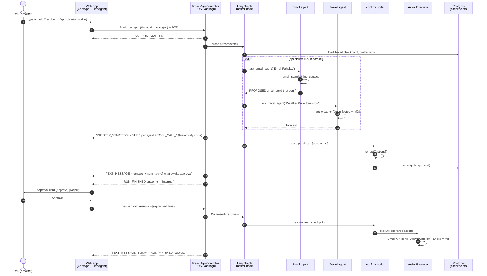

Key points
- **Nothing with side effects runs before approval.** Tools like `gmail_send` only call `propose()`; the real API call
  happens in `ActionExecutor` after the user approves.
- **Stop button:** the web app aborts the run; the brain's `AbortSignal` cancels in-flight model and tool calls and
  the run ends with outcome `cancelled`.
- **Socket.IO is not used here**; the web app streams over AG-UI (Server-Sent Events).

---

## 3. Flow: a Telegram / WhatsApp message

Example: a **voice note** *"remind me at 9 pm to call mom"*.

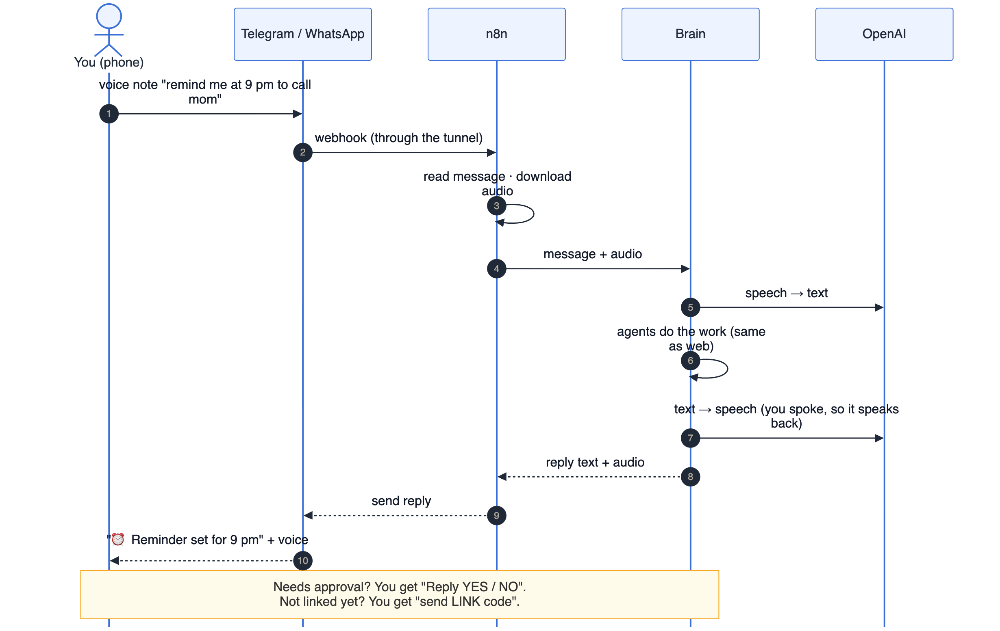

Technical version (Mermaid)

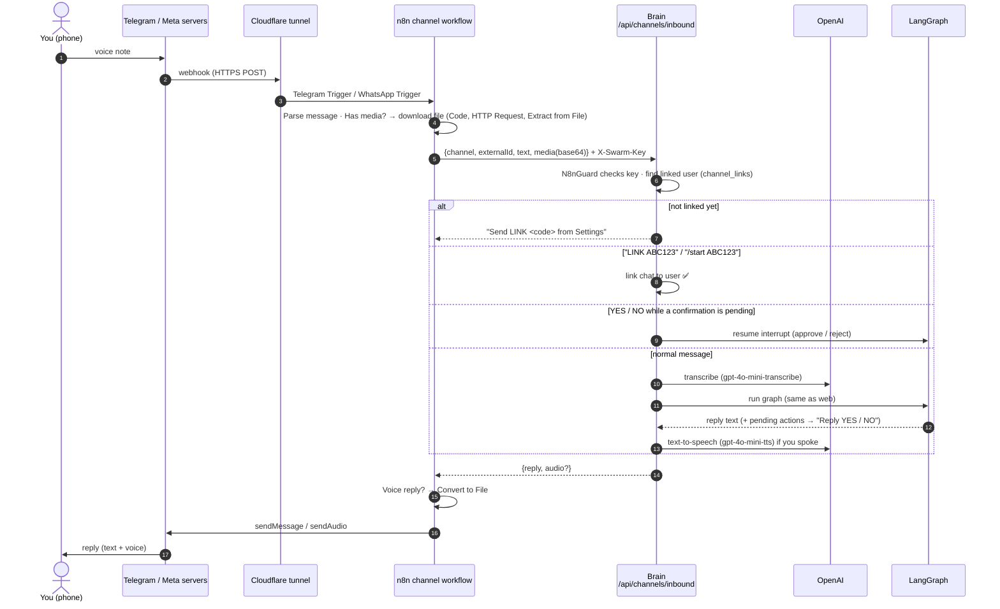

- One conversation thread per user per channel (`telegram-<userId>`, `whatsapp-<userId>`), so context carries over.
- Approvals by text: `YES`, `ok`, `haan`, `👍` … / `NO`, `cancel`, `nahi`, `👎` … (regex in `channels.service.ts`).
- Meta's webhook is verified by n8n (GET challenge) and every POST is checked with the app secret (HMAC signature).

---

## 4. Inside the brain: the LangGraph agent graph

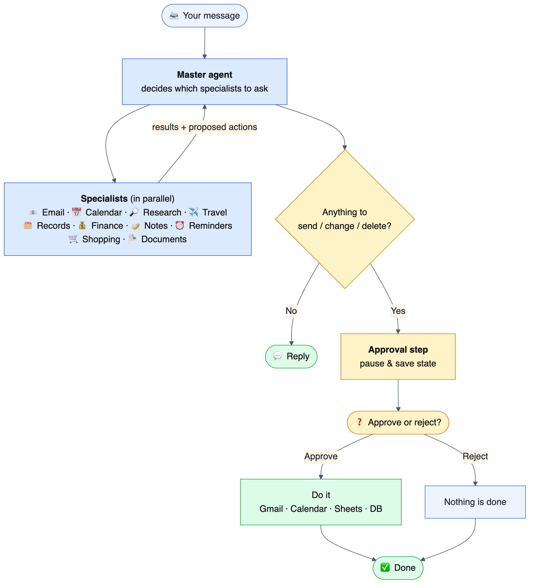

Technical version (Mermaid)

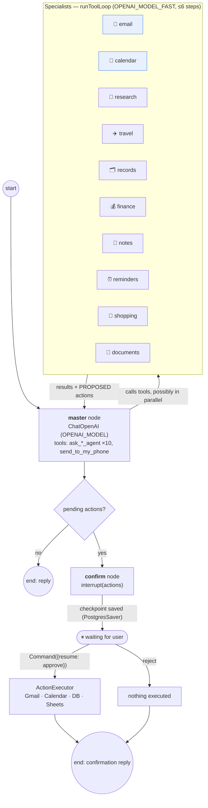

- **Agents as tools:** each specialist is wrapped as a LangChain `tool()` (`ask_email_agent`, …) with a Zod schema, so
  the master model decides which to call and can call several in one turn — they run concurrently.
- **Specialist loop** (`agents/specialist.ts`): model → tool calls → results → model, up to 6 steps, streaming tool
  start/end events to the UI.
- **Grounding rules** (master prompt): act only on the latest message; delegate factual questions to Research instead
  of answering from memory; never ask for confirmation itself — the `confirm` node does that.
- **Memory:** thread state in LangGraph checkpoints (Postgres); long-term facts in `profile_facts`; notes searched by
  meaning with pgvector embeddings.

---

## 5. Flow: scheduler, reminders and proactive messages

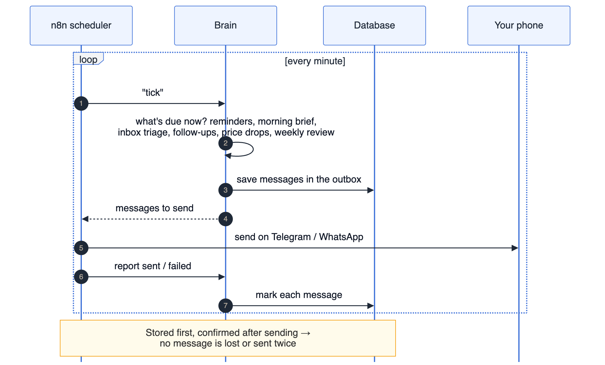

Technical version (Mermaid)

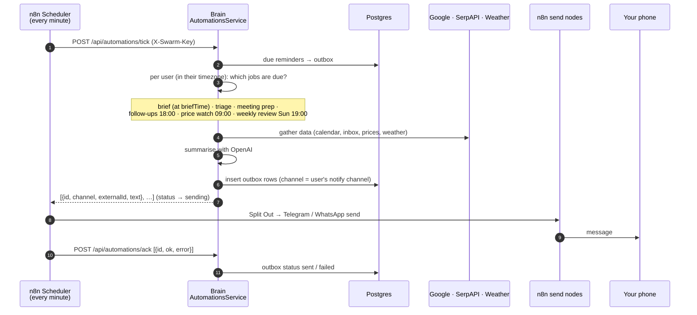

The **outbox pattern** means a message is never lost or sent twice silently: it is stored first, handed to n8n,
and marked `sent`/`failed` only after n8n reports back. If any workflow fails, n8n's **Error handler** workflow
messages the admin Telegram chat.

The master agent can also push a message immediately ("send this to my WhatsApp") through the **n8n MCP server**:
the brain is an MCP *client* (`@langchain/mcp-adapters`) that discovers `send_telegram_message` /
`send_whatsapp_message` from n8n's MCP Server Trigger (Bearer-token protected). The recipient is always filled in by
the brain from your linked chat — the model cannot choose who receives a message.

---

## 6. Flow: connecting Google

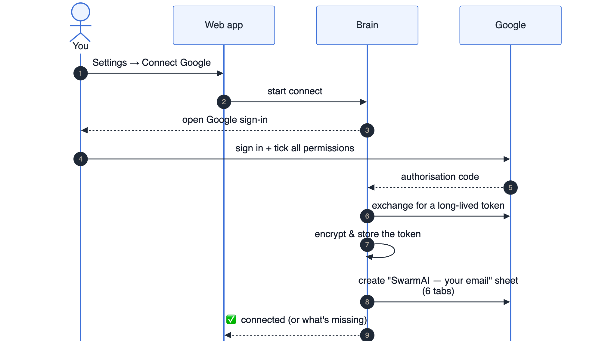

Technical version (Mermaid)

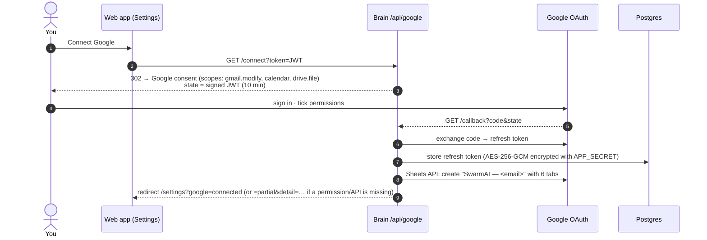

---

## 7. Flow: one-command setup

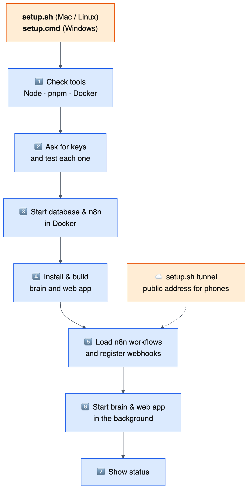

Technical version (Mermaid)

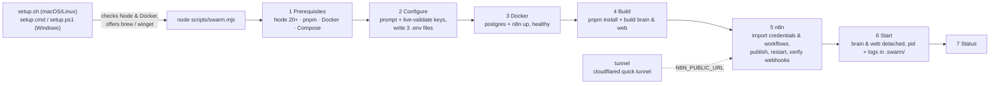

---

## 8. Libraries and frameworks

### 8.1 Brain (`brain/`, Node.js + TypeScript)

| Library | Version | Used for | Where |
|---|---|---|---|
| **NestJS** (`@nestjs/core`, `common`, `platform-express`) | 12 | Application framework: modules, dependency injection, controllers, guards. Every feature (auth, google, chat, channels, automations, agui…) is a Nest module; services are injected into each other and into agent tools. Runs on **Express 5**. | `src/**/*.module.ts`, `*.controller.ts`, `auth/guards.ts` |
| `@nestjs/config` | 12 | Reads `brain/.env` into a typed `ConfigService` (API keys, URLs, models). | everywhere via `ConfigService` |
| `@nestjs/swagger` | 12 | Generates the OpenAPI spec and the Swagger UI at `/api/docs` from decorators (`@ApiOperation`, `@ApiHeader`…). | controllers, `common/openapi.ts`, `main.ts` |
| `@nestjs/typeorm` + **TypeORM** | 12 / 1.1 | ORM for PostgreSQL: entity classes → tables (users, threads, tasks, expenses, reminders, outbox…), repositories for queries, `synchronize` creates the schema in development. | `db/entities.ts`, services' `@InjectRepository` |
| **pg** | 8 | PostgreSQL driver used by TypeORM and by LangGraph's checkpointer; raw SQL for the pgvector table. | `records.service.ts`, checkpointer |
| **LangGraph.js** (`@langchain/langgraph`) | 1.5 | The agent orchestration engine: a `StateGraph` with `master` and `confirm` nodes, `interrupt()` to pause for human approval, `Command({resume})` to continue, streaming of events. | `agents/graph.service.ts` |
| `@langchain/langgraph-checkpoint-postgres` | 1.1 | `PostgresSaver`: saves every conversation's graph state after each step, so a paused approval survives restarts and history is per-thread. Also used to delete a conversation's history. | `graph.service.ts` |
| `@langchain/core` | 1.2 | Building blocks: `tool()` definitions, message types (`HumanMessage`, `AIMessage`, `ToolMessage`), structured output. | `agents/tools/*.ts`, `specialist.ts` |
| `@langchain/openai` | 1.6 | `ChatOpenAI` model wrapper with tool calling and `withStructuredOutput` (e.g. inbox triage schema). | `graph.service.ts`, `automations.service.ts` |
| `@langchain/mcp-adapters` | 2.0 | `MultiServerMCPClient`: connects to n8n's MCP server over HTTP and turns its tools into LangChain tools (`send_telegram_message`, `send_whatsapp_message`). | `integrations/n8n-channels.service.ts` |
| **openai** (official SDK) | 7 | Media features LangChain doesn't cover: speech-to-text (`gpt-4o-mini-transcribe`), text-to-speech (`gpt-4o-mini-tts`), embeddings (`text-embedding-3-small`), vision for receipts/images. | `integrations/openai-media.service.ts` |
| **googleapis** | 186 | Official Google client: OAuth2 (per-user refresh tokens), Gmail (search/read/draft/send/reply/archive), Calendar (list/free-busy/create/update/delete), Sheets (create workbook, append/read rows). | `google/*.service.ts` |
| `@ag-ui/core` + `@ag-ui/encoder` | 1.0.2 | AG-UI protocol: event types (`RUN_STARTED`, `STEP_STARTED` per agent, `TEXT_MESSAGE_CONTENT`, `TOOL_CALL_START`, `RUN_FINISHED` with `interrupt`…) and the SSE encoder used to stream a run to the web app. | `agui/agui-run.ts`, `agui.controller.ts` |
| **zod** | 4 | Schemas for every tool's arguments (the model sees them as JSON Schema), request validation, structured LLM outputs. | `agents/tools/*.ts`, `common/validate.ts` |
| `reflect-metadata`, **rxjs** | — | Required by NestJS decorators/DI; rxjs is used in tests to collect AG-UI event streams. | `main.ts`, `agui-run.spec.ts` |
| Node built-ins `node:crypto`, `fetch` | Node 20+ | JWT-style signed tokens (HMAC), **AES-256-GCM** encryption of Google tokens, **scrypt** password hashing, link codes; `fetch` for all plain HTTP APIs (with a small cache/retry helper). | `common/crypto.ts`, `common/http.ts` |

Dev tools: **TypeScript 6** (ESM, `nodenext`), **@nestjs/cli** (build), **Vitest 4** + **supertest** (unit/API
tests — 12 tests incl. "no side effect without approval" and the AG-UI stream), **oxlint** + **Prettier**.

### 8.2 Web app (`web/`)

| Library | Version | Used for |
|---|---|---|
| **Next.js** (App Router, Turbopack) | 16.4 | Pages (`/`, `/dashboard`, `/memory`, `/settings`, `/login`, `/signup`), production server, PWA manifest (`app/manifest.ts`) and icons. |
| **React** | 19.3 | UI components: `ChatApp`, `Composer` (push-to-talk), `ApprovalCard`, `AgentActivity`, `DashboardView`, `MemoryView`, `SettingsView`. |
| `@ag-ui/client` | 1.0.2 | `HttpAgent` connects to the brain's `/api/agui`, consumes the SSE event stream (text deltas, tool calls, agent activity, interrupts) and sends `resume` decisions for approvals. |
| **Tailwind CSS** 4 (`@tailwindcss/turbopack`) | 4 | Styling with design tokens; light/dark themes. |
| **react-markdown** | 10 | Renders the assistant's markdown answers (bold, lists, links). |
| **lucide-react** | 1.x | Icons (mic, send, stop, check, trash…). |
| Browser APIs | — | `MediaRecorder` for push-to-talk audio, a service worker (`public/sw.js`) for installability/offline shell, `localStorage` for the login token. |

### 8.3 n8n (Docker image `n8nio/n8n:2.43.7`)

| n8n node | Used for |
|---|---|
| **Telegram Trigger** / **WhatsApp Trigger** | Receive messages via webhooks (n8n registers them with Telegram/Meta and verifies Meta's signature). |
| **Code** | Parse incoming payloads (text, voice, photo, document) into one format for the brain. |
| **If** | Branching: has media? voice reply wanted? admin chat configured? |
| **HTTP Request** | Call the brain (`/channels/inbound`, `/automations/tick`, `/ack`) with the `X-Swarm-Key` header; download WhatsApp media. |
| **Extract from File** / **Convert to File** | Media → base64 for the brain; base64 MP3 from the brain → audio file to send back. |
| **Telegram** / **WhatsApp** | Send text and audio replies. |
| **Schedule Trigger** + **Split Out** | Every-minute tick; send each outbox message as its own item. |
| **MCP Server Trigger** + **Telegram Tool** / **WhatsApp Tool** | Expose "send message" tools to the brain over MCP (Bearer auth); parameters filled with `$fromAI`. |
| **Error Trigger** | Error workflow: alert the admin Telegram chat when any workflow fails. |

Workflows are **generated as code** by `n8n/build-workflows.mjs` (fixed ids, so re-imports update instead of
duplicating) and imported/published with the n8n CLI (`import:credentials`, `import:workflow`, `publish:workflow`).

### 8.4 Infrastructure and tooling

| Tool | Used for |
|---|---|
| **Docker Compose** | Runs `pgvector/pgvector:pg17` (PostgreSQL + vector extension) and n8n; `infra/init-db.sql` creates the `swarm` and `n8n` databases and enables `vector`. |
| **PostgreSQL 17 + pgvector** | One database server for app data, LangGraph checkpoints, n8n's own data, and 1536-dimension note embeddings with cosine-distance search. |
| **Cloudflare `cloudflared`** | Quick tunnel that gives n8n a public HTTPS URL for Telegram/WhatsApp webhooks. |
| **pnpm** | Package manager for brain and web. |
| **`scripts/swarm.mjs`** (plain Node, no dependencies) | Cross-platform setup/run tool: prerequisites, key wizard with live validation, Docker, build, n8n import/publish, webhook verification, start/stop with pid files and logs, status/doctor. |
| `setup.sh` / `setup.ps1` / `setup.cmd` | OS launchers for the tool (bash on macOS/Linux, PowerShell on Windows). |

---

## 9. External services and APIs

| Service | Used by | For | Key needed |
|---|---|---|---|
| OpenAI | brain | master + specialist reasoning (`gpt-4.1` / `gpt-4.1-mini`), speech-to-text, text-to-speech, vision, embeddings | `OPENAI_API_KEY` (required) |
| Google Gmail / Calendar / Sheets | brain | email, calendar, the per-user workbook | OAuth client; each user connects |
| SerpAPI | brain | Google web/news search with answer box, Google Flights, Google Hotels, Google Shopping | `SERPAPI_KEY` (optional) |
| Wikipedia API, Google News RSS | brain | keyless research fallback | — |
| Open-Meteo (forecast + geocoding) | brain | weather, India-first place lookup | — |
| IMD district warnings | brain | Indian weather warnings | — |
| Nominatim (OpenStreetMap) | brain | geocoding fallback (rate-limited 1 req/s) | — |
| Yatra AI (travel-planner project) | brain | full India trip plans | local, optional |
| Telegram Bot API | n8n | receive/send Telegram messages | bot token |
| Meta WhatsApp Cloud API | n8n | receive/send WhatsApp messages | access token, app id/secret |
| Cloudflare | tunnel | public HTTPS URL | — (quick tunnel) |
| LangSmith | brain | optional tracing of every run, agent and tool call | `LANGSMITH_API_KEY` |

---

## 10. Why this split (brain vs n8n)

| Concern | Lives in | Reason |
|---|---|---|
| Reasoning, agents, approvals, memory | **Brain (LangGraph)** | Needs code-level control: parallel agents, typed tools, `interrupt()`/resume, per-user isolation, tests. |
| Channel plumbing (webhooks, media download, sending) | **n8n** | Ready-made, maintained Telegram/WhatsApp nodes; webhook registration and signature checks; easy to inspect in the Executions view. |
| Timing (every-minute tick) | **n8n** | Visual, restart-safe scheduler; the brain stays stateless between ticks. |
| User credentials (Google) | **Brain** | Encrypted per user; keeps n8n within its Sustainable Use License (n8n never holds end-users' credentials). |
| Bot/app credentials (Telegram, WhatsApp) | **n8n** | Stored encrypted with `N8N_ENCRYPTION_KEY`; the brain never sees them. |

The two sides talk through three narrow, authenticated interfaces: **HTTP with `X-Swarm-Key`** (n8n → brain),
**MCP with a Bearer token** (brain → n8n), and the **outbox** in the brain's database.

---

_Diagrams: sources are in [`docs/diagrams/*.mmd`](diagrams/). After editing one, run `docs/diagrams/render.sh` to
regenerate the PNG images (uses mermaid-cli via `npx`)._

---

## 11. Platform: organisations, agent registry, knowledge base, customer desk

Full guide: [PLATFORM.md](PLATFORM.md).

**How a run is assembled now.** For every message the brain builds a `RunContext` with the user's **organisation**
(settings, own OpenAI key) and the **agents resolved for this run**:
1. `AgentRegistryService` merges the built-in agents in code with the organisation's `agent_configs` rows.
2. It keeps the agents allowed for the run's audience (members or customers).
3. It builds each agent's tools from the shared catalogue, wrapping tools marked *approval* so they only `propose()`.

The graph (master → confirm) is unchanged. Approved `tool_call` actions run the real tool in the `confirm` node.

**Knowledge base:** ingestion and search.

**Customer desk with human handoff:**
- `ChannelsService` sends unknown senders to `DeskService` when an organisation enabled its desk.
- The run uses `mode: 'customer'`: a stand-in user, customer-safe tools only, and an `escalate_to_human` tool.
- The conversation state is in `conversations` / `conversation_messages`; the LangGraph thread is `desk-<id>`.

Technical version (Mermaid)

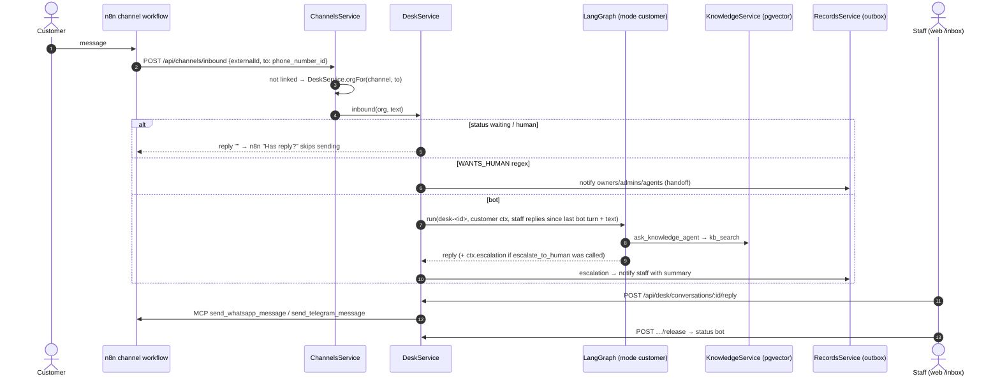

**New libraries**

| Library | Used for | Where |
|---|---|---|
| **unpdf** | PDF text extraction page by page (pdf.js, pure JS, no native deps) | `knowledge/knowledge.service.ts` |
| **mammoth** | Word `.docx` → plain text | `knowledge/knowledge.service.ts` |
| pgvector **HNSW** index | fast cosine search over knowledge passages | `kb_chunks_vec` index |
| Nest `mixin` guards | `RoleGuard('owner','admin')` on admin / desk controllers | `auth/guards.ts` |

