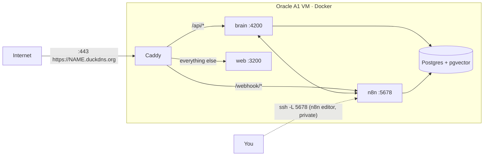

# Deploy SwarmAI on Oracle Cloud Always Free — runbook

Result: SwarmAI running 24×7 at `https://<name>.duckdns.org`, with Telegram/WhatsApp webhooks, HTTPS, nightly backups,
for ₹0/month (plus your OpenAI usage). Why this setup and what it costs: [DEPLOYMENT-FREE.md](DEPLOYMENT-FREE.md).
How it fits together (all components, request paths, operations): [DEPLOYMENT-ARCHITECTURE.md](DEPLOYMENT-ARCHITECTURE.md).



One address serves everything; only ports 22, 80 and 443 are open. The n8n editor is never public.

**Login user:** `ubuntu` on Ubuntu images, `opc` on Oracle Linux (Oracle's default image). The scripts support both;
below, replace `ubuntu@` with `opc@` if your server runs Oracle Linux.

| File | Purpose |
|---|---|
| `brain/Dockerfile`, `web/Dockerfile` | Production images (arm64 and x86) |
| `docker-compose.prod.yml` | Overlay on `docker-compose.yml`: adds brain, web, Caddy; binds internal ports to 127.0.0.1; restarts on failure/reboot |
| `infra/Caddyfile` | HTTPS + routing by path |
| `infra/server-bootstrap.sh` | One-time server preparation |
| `infra/backup.sh` | Nightly dumps of both databases, 14 days, optional upload to Object Storage |
| `setup.sh server-env <domain>` | (your Mac) writes the server's env files into `.swarm/server/` |
| `setup.sh deploy` | (server) build, start, import n8n workflows, register webhooks, check HTTPS |

---

## 1. Oracle account (you, ~20 min)
1. Sign up at **oracle.com/cloud/free** with a card that allows international online payments (temporary
   verification charge, refunded).
2. **Home region:** India West (Mumbai) or India South (Hyderabad). Permanent.
3. Recommended: *Upgrade to Pay As You Go* (still ₹0 inside Always Free) so idle free instances aren't reclaimed, and
   create a **budget** of ₹1 with an email alert (Billing → Budgets).

## 2. Create the server (you, ~15 min)
1. **Compute → Instances → Create instance**
   - Image: **Canonical Ubuntu 24.04** · Shape: **Ampere → VM.Standard.A1.Flex**, **2 OCPU, 12 GB**
   - Networking: create a new VCN with a public subnet, **assign a public IPv4 address**
   - SSH keys: *Paste public key* → contents of `~/.ssh/id_ed25519.pub` from your Mac
   - Boot volume: 100 GB
   - "Out of host capacity" → try another availability domain or retry later.
2. **Open web ports:** Instance → subnet → *Default security list* → *Add ingress rules*: source `0.0.0.0/0`, TCP,
   destination port **80**; same for **443**. (SSH 22 is already there.)
3. Note the instance's **public IP**.

## 3. Address (you, ~5 min)
1. **duckdns.org** → sign in with Google/GitHub → add a subdomain, e.g. `swarm-ai` → set it to the public IP.
2. Keep the **token** (shown on the DuckDNS page) for step 5 — it is typed on the server, not stored in the repo.

## 4. Prepare settings (your Mac)
```bash
./setup.sh server-env swarm-ai.duckdns.org
```
Writes `.swarm/server/.env` and `.swarm/server/brain.env` (git-ignored): your current keys, public URLs for the
domain, fresh production secrets (database password, n8n encryption key, n8n↔brain tokens). `APP_SECRET` stays the
same so migrated data (Google tokens, org keys) still decrypts. The Yatra travel-planner link is disabled on the server.

**Finish the OpenAI key rotation before this step** so the server gets the new key.

## 5. Install (on the server)
```bash
ssh ubuntu@<ip>
git clone https://github.com/priyambansal13/Swarm-Ai-multiagent.git swarm-ai     # private repo: use a deploy key or rsync
cd swarm-ai && bash infra/server-bootstrap.sh swarm-ai                           # asks for the DuckDNS token
exit
```
Then from your Mac copy the settings:
```bash
scp .swarm/server/.env       ubuntu@<ip>:swarm-ai/.env
scp .swarm/server/brain.env  ubuntu@<ip>:swarm-ai/brain/.env
```

## 6. Deploy (on the server)
```bash
ssh ubuntu@<ip>
cd swarm-ai && ./setup.sh deploy
```
First build takes ~5–10 minutes on the A1 VM. At the end: all containers healthy, workflows published, Telegram and
WhatsApp webhooks pointing at `https://swarm-ai.duckdns.org/webhook/…`, HTTPS certificate issued.

## 7. Bring your data (optional, recommended)
Moves your account, organisation, knowledge base and history from the Mac. On the Mac:
```bash
docker exec swarm-db pg_dump -U swarm -d swarm --no-owner --clean --if-exists | gzip > /tmp/swarm.sql.gz
scp /tmp/swarm.sql.gz ubuntu@<ip>:
```
On the server:
```bash
cd swarm-ai && docker compose stop brain
gunzip -c ~/swarm.sql.gz | docker exec -i swarm-db psql -q -U swarm -d swarm
docker compose start brain && rm ~/swarm.sql.gz
```
Without this step, sign up again on the new address (you become owner of a new organisation). The server runs with
`SIGNUP_MODE=invite`: after that first account, others join through **Admin → Members → Create link**.

## 8. After go-live
- **Google:** Cloud Console → APIs & Services → Credentials → your OAuth client → add redirect URI
  `https://swarm-ai.duckdns.org/api/google/callback` (keep the localhost one for the Mac).
- **Telegram/WhatsApp now point at the server.** Don't run `./setup.sh tunnel` on the Mac any more — it would move
  the webhooks back to the laptop. For local development, use the web app only, or a second test bot.
- **Phones:** members re-open the app at the new address and "Add to Home Screen" again.
- **Uptime alert (optional):** UptimeRobot free → `https://swarm-ai.duckdns.org/api/health`.
- **Off-server backups (optional):** Object Storage → create bucket → *Pre-authenticated request* (permit object
  writes) → save the URL in `~/.swarm-backup-url` on the server.

## Everyday operations (on the server, in `~/swarm-ai`)
| Task | Command |
|---|---|
| Update to the latest code | `git pull && ./setup.sh deploy` |
| Status | `./setup.sh status` · `docker compose ps` |
| Logs | `docker compose logs -f brain` (or `web`, `n8n`, `caddy`) |
| Restart one part | `docker compose restart brain` |
| n8n editor | on the Mac: `ssh -L 5678:localhost:5678 ubuntu@<ip>` → open http://localhost:5678 |
| Backup now | `infra/backup.sh` |
| Restore | `gunzip -c ~/swarm-backups/swarm-….sql.gz \| docker exec -i swarm-db psql -U swarm -d swarm` |
| Change a key | edit `.env` / `brain/.env` → `docker compose up -d` (n8n tokens → also `./setup.sh n8n`) |

## Secrets backup (your Mac)
The server can be rebuilt from the repo, but not without its secrets: `.env`, `brain/.env` (incl. `APP_SECRET`, which
decrypts Google tokens and org keys), `web/.env.local` and `.swarm/server/` (database password, n8n encryption key).
Keep an encrypted copy off the Mac:
```bash
cd swarm-ai
PASS="$(openssl rand -base64 33)"
security add-generic-password -U -a swarm-ai -s "SwarmAI secrets backup" -w "$PASS"     # passphrase → macOS Keychain
tar -czf - .env brain/.env web/.env.local .swarm/server/.env .swarm/server/brain.env \
  | PASS="$PASS" openssl enc -aes-256-cbc -pbkdf2 -iter 600000 -salt -pass env:PASS \
    -out ~/Library/Mobile\ Documents/com~apple~CloudDocs/SwarmAI-secrets-backup/SwarmAI-secrets-$(date +%F).tar.gz.enc
```
Restore (into a fresh clone): get the passphrase from Keychain Access ("SwarmAI secrets backup"), then
```bash
PASS='…' openssl enc -d -aes-256-cbc -pbkdf2 -iter 600000 -pass env:PASS -in SwarmAI-secrets-….tar.gz.enc | tar -xzf -
```
Also save the passphrase in a password manager — the Keychain item lives only on this Mac. Make a new backup whenever
a key changes (e.g. after rotating the OpenAI key).

## Troubleshooting
| Symptom | Fix |
|---|---|
| Browser can't reach the address | Check the security list has 80/443; `sudo iptables -L INPUT -n \| head`; DuckDNS points at the right IP (`dig +short NAME.duckdns.org`) |
| Certificate not issued | `docker compose logs caddy` — usually port 80 blocked or DNS not yet updated |
| Web app loads but every call fails | Web image built with the wrong address — check `APP_DOMAIN` in `.env`, then `./setup.sh deploy` |
| Telegram silent | `./setup.sh n8n` re-registers webhooks; check `docker compose logs n8n` |
| Out of memory during build | Swap missing — re-run `infra/server-bootstrap.sh` |
