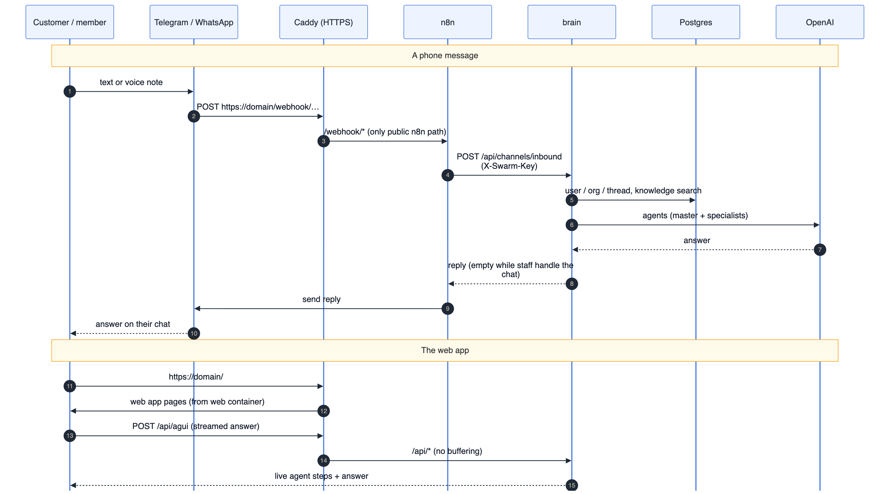
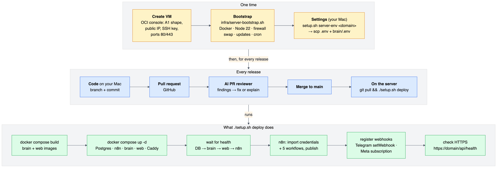
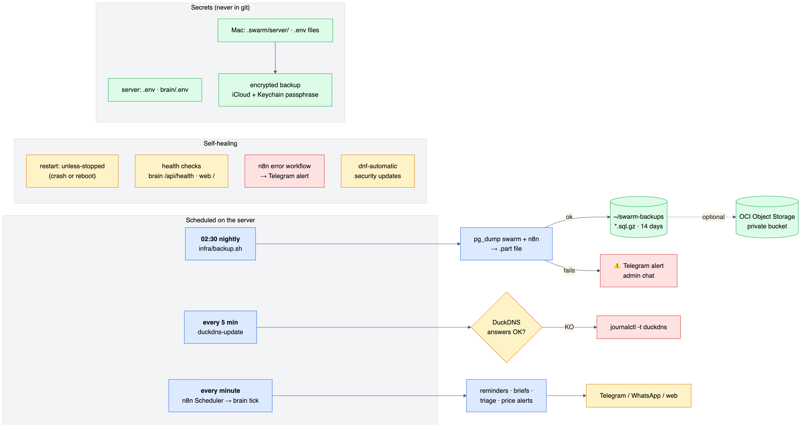

# SwarmAI — deployment architecture

How the production deployment is built: every component, how requests travel, how a release reaches the server, and
how it stays healthy. Step-by-step instructions are in [DEPLOY-ORACLE.md](DEPLOY-ORACLE.md); why this hosting choice
and the alternatives are in [DEPLOYMENT-FREE.md](DEPLOYMENT-FREE.md). Diagram sources: `docs/diagrams/13–16-*.mmd`.

---

## 1. Components and network

One **Oracle Cloud Always Free** VM runs everything in Docker. **Caddy** is the only thing the internet can reach
(ports 80/443); it terminates HTTPS and routes by path to the right container. All other containers listen on
`127.0.0.1` and talk to each other over Docker's private network.

| Container | Image | Port | Public path | Data | Restart / health |
|---|---|---|---|---|---|
| `swarm-caddy` | `caddy:2` | **80, 443** (public) | everything enters here | volumes `caddy_data` (certificates), `caddy_config` | `unless-stopped` |
| `swarm-web` | `swarm-web` (built from `web/Dockerfile`) | 127.0.0.1:3200 | `/` | none | `unless-stopped` · health `GET /` |
| `swarm-brain` | `swarm-brain` (built from `brain/Dockerfile`) | 127.0.0.1:4200 | `/api/*` (incl. `/api/docs`) | in Postgres | `unless-stopped` · health `GET /api/health` |
| `swarm-n8n` | `n8nio/n8n:2.43.7` | 127.0.0.1:5678 | **`/webhook/*` only** | Postgres db `n8n` + volume `swarm_n8n` | `unless-stopped` |
| `swarm-db` | `pgvector/pgvector:pg17` | 127.0.0.1:5434 | none | volume `swarm_pg` (dbs `swarm`, `n8n`) | `unless-stopped` · `pg_isready` |

Files: `docker-compose.yml` (Postgres + n8n, shared with local development) + `docker-compose.prod.yml` (brain, web,
Caddy, localhost-only ports, health checks, required production password). The server's `.env` sets
`COMPOSE_FILE=docker-compose.yml:docker-compose.prod.yml`, so every `docker compose` command uses both.

### Security layers (outside in)
| Layer | What it allows |
|---|---|
| OCI VCN security list | inbound TCP 22, 80, 443 only |
| Host firewall (firewalld) + SELinux | ssh, http, https |
| SSH | key-only login (password login disabled when a key is installed) |
| Caddy | HTTPS only (HTTP → 308 redirect), HSTS with subdomains; routes `/api/*`, `/webhook/*`, `/` — the n8n editor and REST API return 404 |
| Containers | bound to 127.0.0.1; reachable only through Caddy or an SSH tunnel |
| Brain | login tokens, roles (owner/admin/agent/member), customer-safe tool list, approvals before side effects, audit log |
| Sign-up | `SIGNUP_MODE=invite` on servers: only the first account and people with an invite link |
| n8n → brain | shared secret header `X-Swarm-Key`; brain → n8n MCP with a bearer token |

### External services
| Service | Used by | For | Cost |
|---|---|---|---|
| DuckDNS | cron on the server | `your-name.duckdns.org` → server IP | free |
| Let's Encrypt | Caddy | HTTPS certificate, renewed automatically | free |
| Telegram Bot API | n8n | messages in (webhook) and out | free |
| Meta WhatsApp Cloud API | n8n | messages in (webhook) and out | Meta's pricing |
| OpenAI | brain | chat, knowledge embeddings, voice | pay per use (or an organisation's own key) |
| Google (Gmail, Calendar, Sheets) | brain | each member's own account (OAuth) | free |
| SerpAPI, Open-Meteo, IMD | brain | search, flights/hotels/shopping, weather | free tiers |

---

## 2. How a request travels

- **Phone message:** Telegram/WhatsApp → `https://domain/webhook/…` → Caddy → n8n → `POST /api/channels/inbound` on
  the brain → agents (OpenAI, knowledge search in Postgres) → reply back through n8n to the person's own chat. While a
  staff member handles a customer chat the brain returns an empty reply and n8n sends nothing.
- **Web app:** pages come from the web container; the app calls `https://domain/api/…`; chat answers stream over
  `POST /api/agui` (Caddy flushes immediately, so steps appear live).
- **Scheduler:** every minute n8n calls the brain's `/api/automations/tick` over the private network and delivers
  what's due (reminders, briefs, alerts).

---

## 3. From code to production

- **One time:** create the VM, run `infra/server-bootstrap.sh`, then on your computer `./setup.sh server-env <domain>`
  and copy the two env files to the server.
- **Every release:** branch → pull request → AI PR review → merge to `main` → on the server
  `cd swarm-ai && git pull && ./setup.sh deploy`.
- **`./setup.sh deploy`:** builds the brain and web images, starts all containers, waits for each to be healthy,
  imports the n8n credentials and 5 workflows, registers the Telegram and WhatsApp webhooks on the public URL, and
  checks HTTPS. Re-running it is safe.

---

## 4. Keeping it healthy

| Concern | How it's handled |
|---|---|
| Crash or reboot | every container `restart: unless-stopped`; Docker starts on boot |
| Is it working? | health checks (`docker compose ps` → healthy); `./setup.sh status`; `https://domain/api/health` |
| Workflow errors | n8n error workflow → Telegram message to the admin chat |
| Database backups | `infra/backup.sh` nightly 02:30, both databases, 14 days in `~/swarm-backups`; optional private OCI Object Storage bucket |
| Failed backup | Telegram alert to the admin chat; no partial file kept |
| IP change | DuckDNS updater every 5 minutes; failures in `journalctl -t duckdns` |
| Certificates | Caddy renews automatically |
| OS security | `dnf-automatic` security updates |
| Secrets | `.env` and `brain/.env` on the server (git-ignored); master copy in `.swarm/server/` on your computer; encrypted backup (see DEPLOY-ORACLE.md) |

### Where data and secrets live
| What | Where | Backed up by |
|---|---|---|
| Users, organisations, knowledge base, conversations, tasks, memory | Postgres db `swarm` (volume `swarm_pg`) | nightly dump |
| n8n workflows, credentials (encrypted), run history (7 days) | Postgres db `n8n` + volume `swarm_n8n` | nightly dump; workflows are also regenerated from `n8n/build-workflows.mjs` |
| HTTPS certificates | volume `caddy_data` | re-issued automatically if lost |
| API keys, DB password, `APP_SECRET`, n8n encryption key | server `.env`, `brain/.env`; your computer `.swarm/server/`, `.env` files | encrypted secrets backup (iCloud + Keychain passphrase) |
| Code | GitHub `main` | git |

### Capacity (measured on the 1 OCPU / 6 GB VM, idle)
| | Memory | Notes |
|---|---|---|
| n8n | ~440 MB | largest component |
| brain | ~200 MB | grows with concurrent chats |
| Postgres | ~100 MB | |
| web | ~65 MB | |
| Caddy | ~20 MB | |
| **Total** | **~0.8 GB of 5.5 GB** | plus 4 GB swap; builds use the most memory |

Disk: images ~4.4 GB (n8n 1.7 GB, web 1.1 GB, brain 0.9 GB, Postgres 0.65 GB). Rebuilds leave Docker build cache
behind — reclaim it with `docker builder prune -f` if `df -h /` gets above ~80 %.

---

## 5. What happens when…

| Event | Effect | Recovery |
|---|---|---|
| A container crashes | Docker restarts it within seconds | automatic |
| The VM reboots | all containers start again; webhooks unchanged | automatic |
| Your Mac is off | no effect — the server is independent | — |
| Someone runs `./setup.sh tunnel` / `n8n` on a laptop | Telegram/WhatsApp webhooks move to the laptop | on the server: `./setup.sh n8n` |
| The public IP changes | DuckDNS updated within 5 minutes | automatic |
| A backup fails | Telegram alert | check `~/swarm-backups/backup.log` |
| The disk fills up | builds and backups fail | `docker builder prune -f`, old backups are auto-deleted after 14 days |
| The VM is lost | site down | new VM → bootstrap → copy env files from the secrets backup → deploy → restore the latest dump |
| Oracle changes free limits | instance may be stopped | resize within the new limits (we use well under them) |

Single server, no failover: right for demos and early pilots. For contractual uptime, add a second region or a
managed database ([DEPLOYMENT-FREE.md §6](DEPLOYMENT-FREE.md#6-when-to-stop-being-free)).
