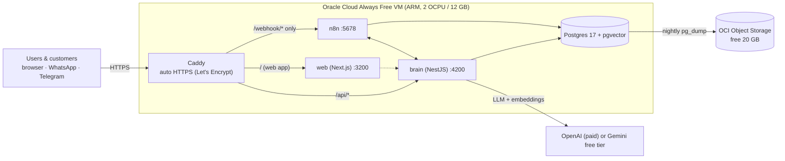

# Deploying SwarmAI at zero cost — plan

_Plan, 18 Oct 2026. Free-tier limits change often (two big ones changed this year); re-check the linked pages before
starting._

**Goal:** SwarmAI running 24×7 on the internet with a fixed HTTPS address, so Telegram and WhatsApp work without your
laptop, for ₹0 per month.

**Short answer:** everything except the AI model can be hosted free on one **Oracle Cloud Always Free** VM, with a
free **DuckDNS** address and **Caddy** for HTTPS. The AI is the only part with a real cost; it can be made free for
demos with **Gemini's free tier** (small code change), but keep OpenAI (or the client's own key) for real customers.
Don't want Oracle? See **[§7 Alternatives](#7-alternatives-to-oracle)** — the best one is a spare computer at home
with **Tailscale Funnel**.

---

## 1. Target setup

| Piece | Free service | Free limit (check) | Enough? |
|---|---|---|---|
| Server | Oracle Cloud **Always Free** Ampere A1 VM | 2 OCPU, 12 GB RAM (cut from 4/24 on 15 Jun 2026), 200 GB block storage | Yes — the whole stack needs ~3–4 GB |
| Address | **DuckDNS** subdomain | 5 subdomains per account | Yes — we need 1 (everything is routed by path) |
| HTTPS | **Caddy** + Let's Encrypt | free, auto-renewing | Yes |
| Database | Postgres + pgvector in Docker on the VM | VM disk | Yes |
| Backups | OCI **Object Storage** | 20 GB Always Free | Yes for small orgs |
| Telegram | Bot API | free | Yes |
| WhatsApp | Meta Cloud API | test number free (5 recipients); customer-initiated service replies currently free inside the 24 h window | Demo yes; real number needs Meta Business verification (free, takes time) |
| Google (Gmail/Calendar/Sheets) | Google Cloud OAuth | free (testing mode: up to 100 test users) | Yes for you and a few staff |
| Web search | SerpAPI | 250 searches / month | Demo yes |
| Weather | Open-Meteo + IMD | free | Yes |
| AI | **OpenAI** (paid) or **Gemini** free tier | Gemini free tier cut in Apr 2026 (Flash only, low requests/minute) | Demo only |
| Uptime alerts | UptimeRobot free / n8n error workflow | 50 monitors | Yes |

### Why not the "easy" free platforms?
- **Render / Railway / Fly free tiers**: free web services sleep after 15 idle minutes and take ~1 minute to wake.
  Telegram/WhatsApp webhooks time out, and the every-minute scheduler stops. Not suitable for n8n or the brain.
- **Vercel Hobby** for the web app: works technically, but the Hobby plan is for non-commercial use — fine for a
  personal demo, not for clients. One VM is simpler anyway.
- **Neon / Supabase free Postgres** (pgvector included, 0.5 GB on Neon): an option if the VM disk ever becomes the
  bottleneck, but adds a second account and latency for no gain at this size.
- **Your laptop + quick tunnel** (what we do today): free, but the URL changes on every restart and it's offline when
  the laptop sleeps.

## 2. Code changes — done

Dockerfiles for brain and web, `docker-compose.prod.yml`, `infra/Caddyfile` (one address, routed by path; the n8n
editor stays private), `infra/server-bootstrap.sh`, `infra/backup.sh`, and the `setup.sh server-env` / `setup.sh
deploy` commands. Optional and not built yet: `OPENAI_BASE_URL` support for Gemini's free tier.

## 3. Step by step

Follow **[DEPLOY-ORACLE.md](DEPLOY-ORACLE.md)** — account, server, DuckDNS, settings, install, deploy, data
migration, after go-live, everyday operations and troubleshooting.

## 4. AI cost: the honest part

| Option | Monthly cost | Use for |
|---|---|---|
| Gemini free tier (via OpenAI-compatible endpoint) | ₹0 | Your own demos. Low request limits (a few per minute on Flash after the Apr 2026 cut) — a busy chat will hit them. Google may use free-tier data to improve its products, so **don't send client or customer data**. |
| OpenAI with `gpt-4.1-mini` for everything | roughly ₹1–2 per customer conversation; a light personal demo is ₹100–300/month | Pilots |
| Client's **own OpenAI key** (already supported per organisation) | ₹0 to you | Paying clients — they pay OpenAI directly |

The voice-note features (transcription, read-aloud) also use OpenAI; on the free path, turn voice off or use a free
transcription tier (e.g. Groq's Whisper), which needs the same base-URL change.

## 5. Risks of the free setup

| Risk | Mitigation |
|---|---|
| Oracle reclaims **idle** Always Free instances on free-only accounts | The stack's scheduler keeps it busy, but the safe fix is upgrading the account to Pay-As-You-Go (still ₹0 inside Always Free limits) and setting a **budget alert at ₹1** |
| Oracle changes free limits again without notice (as in Jun–Aug 2026) | Stay well below limits (we use ~1/3); backups off the VM; the compose file runs on any VPS if you must move |
| Single VM = single point of failure | Backups + documented restore; acceptable for demos and early pilots |
| DuckDNS outage or name taken | A paid domain later (~₹800/yr) + Cloudflare named tunnel is the first thing to buy |
| Meta test number only reaches 5 phones | Real WhatsApp number per client with Business verification |
| n8n licence for commercial hosting | Fine for your own use; check before hosting for paying clients |

## 6. When to stop being free

Move to paid pieces in this order, only when needed: **domain** (credibility and stable URLs) → **OpenAI credits** or
client keys (real traffic) → **a second region/VM or managed Postgres** (uptime promises in a contract).

## 7. Alternatives to Oracle

What SwarmAI needs from a host: **always on** (webhooks + every-minute scheduler), **~2–4 GB RAM** for Postgres,
n8n, brain and web together, and a **stable HTTPS URL on port 443 or 8443** (Telegram only accepts 443, 80, 88 or 8443
for webhooks).

| Option | Free for | Fits SwarmAI? | Verdict |
|---|---|---|---|
| **A. Your own spare computer + Tailscale Funnel** | forever | Yes — any old laptop, desktop, Mac mini or Raspberry Pi 5 (8 GB) | ★ Best non-Oracle option |
| **B. Google Cloud e2-micro** (Always Free) | forever | Tight — 1 GB RAM, US regions only; needs Postgres moved to Neon and swap | Works, slow |
| **C. Northflank free sandbox** + Neon | forever (limits) | Partly — 2 always-on services + 1 database; web app must go elsewhere; small instances, bandwidth billed beyond free | Possible, fiddly |
| **D. Cloud credits** — AWS (Free plan: $100–200, closes after 6 months), Azure (B1s 1 GB VM for 12 months + $200 for 30 days), Google Cloud ($300 trial) | 1–12 months | Yes while credits last | Good for a pilot, not permanent |
| Render, Railway, Koyeb, Fly.io, Hugging Face Spaces | — | No — sleep after 15–60 idle minutes, or no free tier / Docker needs a paid plan | Skip |

### A. Your own computer + Tailscale Funnel (recommended if Oracle is out)

**Tailscale Funnel** (free Personal plan) gives the machine a permanent public address like
`https://swarm.your-tailnet.ts.net` with automatic HTTPS — no domain, no router port-forwarding, no changing tunnel
URL. Funnel listens only on ports 443, 8443 and 10000, so put everything on **443 and route by path** (the brain's
routes already start with `/api`, and n8n's webhooks with `/webhook`):

| Public path on `https://swarm.<tailnet>.ts.net` | Goes to |
|---|---|
| `/api/…` | brain `localhost:4200` |
| `/webhook/…` | n8n `localhost:5678` (Telegram + WhatsApp webhooks only) |
| `/` | web app `localhost:3200` |
| n8n editor | **not public** — `tailscale serve` on 8443, reachable only from your own devices on the tailnet |

Steps:
1. Machine: any spare computer with ≥ 4 GB RAM (8 GB comfortable), wired internet, sleep disabled, auto-restart
   after power failure (BIOS setting), ideally on a small UPS. Ubuntu Server, or keep macOS/Windows with Docker.
2. Install Docker and Tailscale; `tailscale up`; enable Funnel for the machine in the Tailscale admin console.
3. Start the stack as today (`./setup.sh`), then publish:
   `tailscale funnel --bg --set-path /api http://localhost:4200/api`,
   `tailscale funnel --bg --set-path /webhook http://localhost:5678/webhook`,
   `tailscale funnel --bg http://localhost:3200`, and `tailscale serve --bg --https=8443 http://localhost:5678`.
4. Set `N8N_PUBLIC_URL`, `PUBLIC_API_URL`, `WEB_URL`, `CORS_ORIGIN`, `NEXT_PUBLIC_API_URL` and the Google redirect URI to
   the `ts.net` address; rebuild the web app; run `./setup.sh n8n` to register the webhooks once.
5. Code changes: a `setup.sh funnel` command (replacing `tunnel`) and starting the stack on boot (systemd /
   launchd). The Dockerfiles from §2 are optional here.

Cost: electricity only — a Raspberry Pi 5 uses ~5–8 W (≈ ₹40/month), an old laptop ~15–25 W (≈ ₹100–150/month).
Risks: home power or internet cuts take it offline (UPS + n8n error alerts help); your home upload speed limits
large file uploads; Funnel has an unpublished bandwidth cap (fine for chat traffic). Good for demos and a first
pilot; move to a cloud VM before promising uptime in a contract.

### B. Google Cloud e2-micro (always free, but small)

One e2-micro VM (2 shared vCPUs, **1 GB RAM**, 30 GB disk) in `us-west1`, `us-central1` or `us-east1`. To fit:
move Postgres to **Neon's free tier** (0.5 GB, pgvector supported), add 2–3 GB swap, run brain + n8n + web in Docker,
Caddy for HTTPS with a DuckDNS name. Expect slow first responses when memory swaps, and ~250 ms extra latency from
India. Neon's 0.5 GB caps the knowledge base at a few thousand passages.

### C. Northflank free sandbox

Two always-on services (brain and n8n) and one database addon, or Neon for Postgres + pgvector. The web app needs a
third home: Vercel Hobby (personal/non-commercial only) or serve it as a static export. Free instances are small, and
bandwidth and database storage beyond the free allowance are billed — set a spending limit. Needs the Dockerfiles
from §2.

### D. Credits for a pilot

AWS's Free plan ($100 + up to $100 more, account closes after 6 months), Azure's 12-month B1s VM (1 GB — same
squeeze as option B) or Google Cloud's $300 90-day trial can run the full Docker Compose stack comfortably for the
length of a pilot. Set budget alerts on day one and plan the move before credits end.

---

Sources checked on 18 Oct 2026:
[Oracle Always Free resources](https://docs.oracle.com/en-us/iaas/Content/FreeTier/resourceref.htm) ·
[Oracle free tier cut (InfoQ)](https://infoq.com/news/2026/07/oracle-cloud-free-tier-limits/) ·
[Gemini rate limits](https://ai.google.dev/gemini-api/docs/rate-limits) ·
[Gemini pricing changes Apr 2026](https://agentdeals.dev/gemini-api-pricing-changes) ·
[Cloudflare quick tunnels](https://developers.cloudflare.com/cloudflare-one/networks/connectors/cloudflare-tunnel/do-more-with-tunnels/trycloudflare/) ·
[Neon pricing](https://neon.com/pricing) ·
[Render free tier spin-down](https://livemy.app/blog/render-pricing) ·
[Tailscale Funnel ports and limits](https://www.ssdnodes.com/learn/tailscale-funnel-limits-and-ports) ·
[Tailscale free plan](https://costbench.com/software/ztna/tailscale-ztna/free-plan/) ·
[Google Cloud free tiers 2026](https://freetier.co/articles/cloud-provider-free-tiers-2026) ·
[Northflank pricing](https://northflank.com/pricing) ·
[Koyeb scale to zero](https://www.koyeb.com/docs/run-and-scale/scale-to-zero) ·
[Hugging Face Spaces](https://huggingface.co/docs/hub/spaces-overview) ·
[AWS Free Tier 2026](https://infratally.com/articles/aws-free-tier-2026/) ·
[Azure free tier 2026](https://agentdeals.dev/azure-free-tier-2026)
