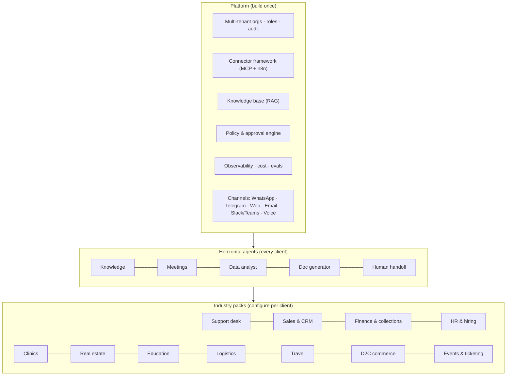
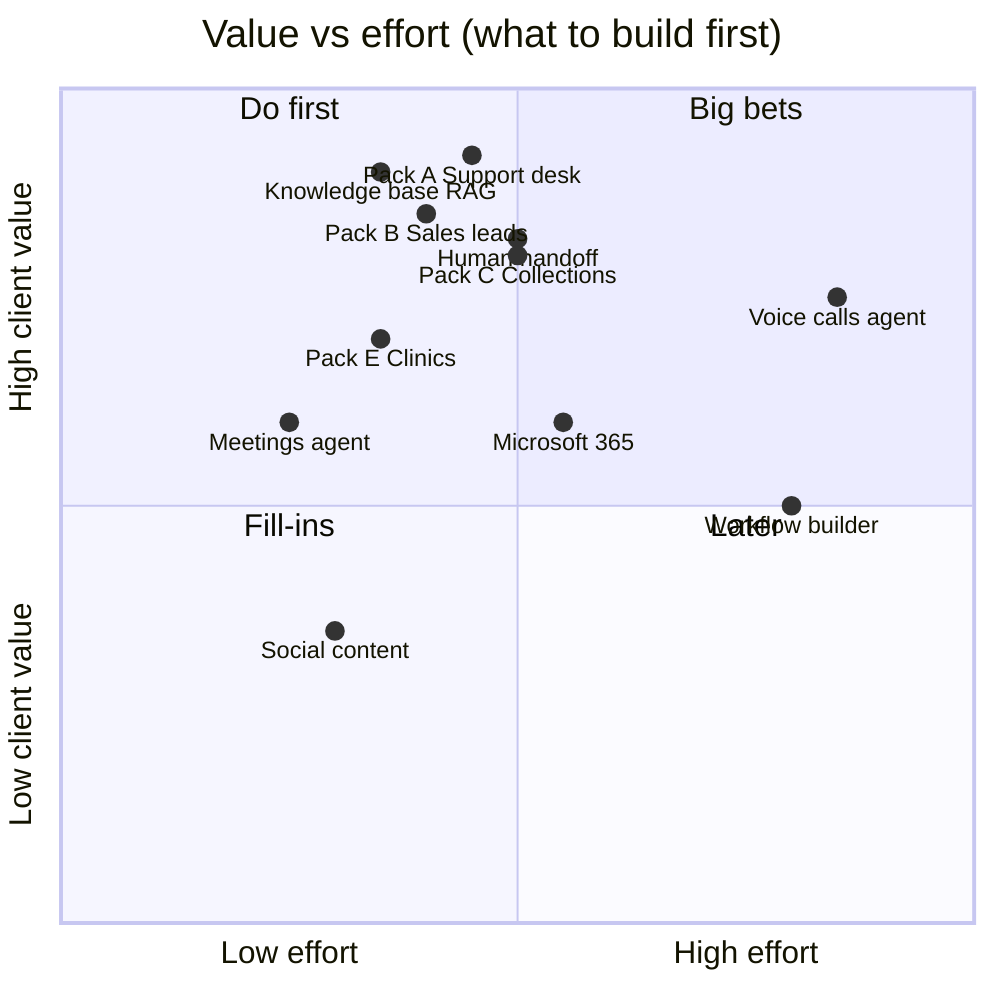

# SwarmAI — expansion plan: new agents, tools and flows to pitch to clients

_Status: proposal (17 Oct 2026). Effort figures are rough engineering-day estimates for one developer who knows this
codebase; validate them before quoting a client._

---

## 0. The idea in one paragraph

SwarmAI today is a personal assistant. Underneath, it is a **reusable agent platform**: a LangGraph brain with
specialist agents, an **approval step before any side effect**, memory, a scheduler, and delivery on **WhatsApp,
Telegram and the web** through n8n. Clients don't buy "a chatbot"; they buy **an outcome on a channel their customers
already use**: fewer missed leads, faster support, invoices chased, appointments filled. The plan is to (1) harden the
platform for multiple client organisations, (2) add **horizontal agents** every client needs, and (3) package
**industry packs** — preset agents + tools + flows + a demo — that can be configured per client in days, not built
from scratch.

---

## 1. What we already have that sells

| Asset (built) | Why a client cares |
|---|---|
| Approval-first agents (`interrupt()` before email/calendar/delete) | "The AI never sends or deletes anything without a human OK" — the #1 objection answered |
| WhatsApp + Telegram + web with **voice notes in and out** | Works where Indian customers and field staff already are; voice for low-literacy users |
| Parallel multi-agent orchestration | One message can do several jobs at once ("log expense, remind me, check weather") |
| Scheduler + outbox (reliable proactive messages) | Reminders, follow-ups and daily briefs that are never lost or duplicated |
| Google Workspace (Gmail, Calendar, Sheets) per user | Fits the tools SMBs actually run on; Sheets as a familiar "database" |
| India-first data (IMD warnings, Indian geocoding, INR, Hinglish YES/NO) | Local fit competitors lack |
| Fact-checking research agent with sources, SerpAPI (flights, hotels, shopping) | Fewer hallucinations, live prices |
| Swagger API, AG-UI streaming, one-command cross-platform setup | Fast to deploy and integrate per client |
| Sibling projects: **cold-chain dispatch** (LangGraph + SOP RAG + telemetry), **Yatra AI** travel planner, **ticketing system** (events, seats, payments) | Ready-made seeds for the Logistics, Travel and Events packs |

---

## 2. Platform upgrades needed before selling (Phase 1)

These are prerequisites for any paying client; most packs depend on them.

| # | Upgrade | What it means | Effort |
|---|---|---|---|
| P1 | **Multi-tenancy** | `organizations` table; every row scoped by `orgId` as well as `userId`; per-org settings, branding, keys and channel numbers | 6–8 d |
| P2 | **Roles & permissions** | owner / admin / agent (human staff) / member / end-customer; per-role tool access (e.g. only finance role can approve payouts) | 4–5 d |
| P3 | **Config-driven agents** | Move `AGENTS` from code (`agents.ts`) to a per-org registry (DB/YAML): prompt, model, enabled tools, approval rules. Packs become configuration | 5–7 d |
| P4 | **Policy & approval engine** | Rules beyond "always confirm": by amount (refund > ₹2,000 → manager), by recipient (external domain), by time; multi-step approvals; approver can be a different person than the requester | 5–6 d |
| P5 | **Connector framework** | Every new integration as an **MCP server** (own code or n8n MCP trigger) with per-org OAuth/API-key storage, so adding Zoho, HubSpot or Tally doesn't touch the brain | 6–8 d |
| P6 | **Knowledge base (RAG)** | Upload PDFs/Docs/URLs/Drive folders → chunk → embed (pgvector, already used for notes) → cited answers; per-org collections; re-sync | 6–8 d |
| P7 | **Human handoff & inbox** | When the bot is unsure or the customer asks, route the conversation to a staff inbox in the web app; staff reply on the same WhatsApp thread; bot resumes | 8–10 d |
| P8 | **WhatsApp Business templates** | Template registry and opt-in tracking, so proactive messages (reminders, payment links) work outside the 24-hour window | 3–4 d |
| P9 | **Observability, cost, evals** | LangSmith on by default; tokens and ₹ cost per org/agent; a regression eval set per pack (golden questions incl. the Diwali-date class of errors) run in CI | 5–6 d |
| P10 | **Admin console** | Web pages for org admins: users, channels, agents on/off, knowledge sources, approval queue, audit log, usage | 8–10 d |
| P11 | **Microsoft 365** | Outlook mail, Outlook calendar, Excel/OneDrive, Teams via Microsoft Graph — many corporates aren't on Google | 6–8 d |
| P12 | **Deployment & compliance** | Hosted multi-tenant on a VPS/cloud with backups, or a per-client install (the setup script already helps); DPDP Act 2023 duties: consent, purpose limitation, deletion on request (deletion now covers chat history), data export | 5–7 d |
| P13 | **n8n licence decision** | n8n's Sustainable Use License covers internal business use. Hosting n8n as part of a service sold to several clients likely needs n8n's commercial/embed licence — **get this confirmed**. Options: per-client installs owned by the client, buy the licence, or move channel webhooks into the brain (the brain already does the thinking) | 1 d decision; 8–10 d if moving channels into the brain |

**Phase 1 total: ≈ 10–12 weeks** for P1–P10 + P13 decision; P11/P12 can run in parallel with the first pack.

---

## 3. New horizontal agents (useful to every client)

Each agent below follows the existing pattern: a spec (prompt + tools) the master calls as `ask_<id>_agent`; side
effects go through `propose()` and the approval step.

| Agent | Tools (new unless noted) | Example | Approval needed for | Effort |
|---|---|---|---|---|
| **Knowledge** | `kb_search` (pgvector, cited chunks), `kb_list_sources`, `read_url` (existing) | "What's our refund policy for damaged items?" → answer with document + page | — | with P6 |
| **Meetings** | `transcribe_recording` (OpenAI STT, existing service), `summarise_meeting`, `extract_action_items`, `create_tasks` (existing), `send_minutes` | Upload a call recording → minutes, decisions, owners, tasks created, minutes emailed | emailing minutes | 4–5 d |
| **Data analyst** | `query_sheet` (existing read), `run_sql_readonly` (allow-listed views), `make_chart` (PNG/HTML), `explain_trend` | "Which product sold most in Tier-2 cities last month? Chart it." | — | 6–7 d |
| **Document generator** | `fill_template` (Google Docs / DOCX), `export_pdf`, `make_quote`, `make_invoice` (GST fields) | "Make a quotation for 50 units at ₹1,200 + 18% GST for Acme" | sending to customer | 5–6 d |
| **Human handoff** | `escalate_to_human`, `summarise_for_agent`, `set_conversation_status` | Angry customer / low confidence → staff gets summary; bot pauses | — | with P7 |
| **Translator (Indic)** | `detect_language`, `translate` (LLM; optional Bhashini/Sarvam API), reply in the customer's language | Customer writes in Tamil → staff sees English → reply goes back in Tamil | — | 3 d |
| **Forms & surveys** | `ask_form` (multi-step WhatsApp form), `save_response` (Sheet/DB), `nps_survey` | Collect KYC fields, feedback, registration on WhatsApp | — | 4 d |
| **Social & content** | `draft_post`, `schedule_post` (LinkedIn/Instagram via APIs or Buffer), `reply_suggestions` | "Draft 3 LinkedIn posts about our Diwali offer" | publishing | 5–6 d |
| **Workflow builder** (advanced) | `propose_workflow` → generates an n8n workflow JSON from a sentence, shows it, imports on approval | "Every Monday 9 am, email me last week's unpaid invoices" | importing/activating | 8–10 d |
| **Payments** | `create_payment_link` (Razorpay / Cashfree / Stripe), `check_payment_status`, `refund` | "Send Rahul a payment link for ₹4,500" | creating links above a limit, refunds (always) | 4–5 d |

---

## 4. Industry packs (what we pitch)

Each pack = **agents + tools + flows + a 10-minute demo + KPIs**. The client mostly supplies data (FAQs, price list,
calendar, CRM access) and a WhatsApp number.

### Pack A — WhatsApp Support Desk (any B2C business) ★ lead offer
- **Who:** clinics, D2C brands, service centres, coaching institutes, housing societies.
- **Agents:** Knowledge, Support (order/booking status, ticket create/update), Human handoff, Translator, Forms.
- **Tools:** `kb_search`, `lookup_order` (Shopify/WooCommerce/custom API via MCP), `create_ticket` / `update_ticket`
  (built-in tickets table, or Freshdesk/Zoho Desk), `escalate_to_human`, `csat_survey`.
- **Flows:** inbound question → answer with source or escalate · ticket SLA breach → alert manager · resolved →
  CSAT 1–5 → weekly support report (top questions, unanswered → suggested FAQ additions).
- **Demo:** customer voice note in Hindi "my order hasn't arrived" → status + ETA in Hindi → asks for a refund → staff
  approves in web inbox → customer gets confirmation.
- **KPIs:** % auto-resolved, first-response time, CSAT, tickets/agent.

### Pack B — Sales & Lead Assistant
- **Agents:** Lead qualifier, CRM, Follow-up, Document generator (quotes), Calendar (existing).
- **Tools:** `capture_lead` (WhatsApp click-to-chat, website form webhook, IndiaMART/JustDial lead email parser),
  `qualify_lead` (BANT questions), `crm_upsert` (HubSpot / Zoho CRM / Sheets), `book_demo` (free slots — existing),
  `make_quote`, `send_brochure`.
- **Flows:** new lead → reply within 1 minute → qualify → book demo on the rep's calendar · no reply in 2 days → nudge
  (template) · daily pipeline digest to the sales head · quote sent → follow-up after 3 days.
- **Demo:** lead from a website form → WhatsApp greeting → 3 questions → demo booked → rep gets a brief.
- **KPIs:** lead response time, lead→demo conversion, leads lost to no follow-up.

### Pack C — Finance & Collections (SMBs, CA firms)
- **Agents:** Finance (existing, extended), Collections, Document generator, Data analyst.
- **Tools:** `read_invoice` (vision — extends `read_receipt`), `gst_validate` (GSTIN format + checksum; public GST
  search where permitted), `make_invoice`, `create_payment_link`, `payment_status`, `ledger_sync`
  (Tally via its XML/HTTP interface, Zoho Books API), `ageing_report`.
- **Flows:** vendor bill photo/email → extracted, GST checked → approval → entered in books · invoice due → polite
  WhatsApp reminder with payment link (template) → escalate tone at +7/+15 days → mark paid on webhook · month-end:
  P&L snapshot and top overdue customers to the owner.
- **Demo:** forward a bill photo → structured entry + approval → customer gets a payment link → pays → ledger updated.
- **KPIs:** days sales outstanding (DSO), hours saved on data entry, % invoices paid on time.

### Pack D — HR & Hiring
- **Agents:** Recruiter, Interview scheduler, Onboarding, HR policy (Knowledge on the handbook), Leave.
- **Tools:** `parse_resume` (PDF → structured), `score_against_jd` (rubric, explainable), `schedule_interview` (panel
  free slots — existing calendar tools), `send_offer_letter` (template), `onboarding_checklist`, `apply_leave` /
  `leave_balance` (Sheet or HRMS such as Keka/Zoho People via API).
- **Flows:** new application → screen → shortlist summary to HR (approval) → candidate picks a slot on WhatsApp →
  reminders → feedback form to panel · joiner → day-1 checklist and policy Q&A.
- **Guardrail:** scoring must be explainable and reviewed by a human; never auto-reject (bias/fairness).
- **KPIs:** time-to-schedule, time-to-hire, HR hours per hire.

### Pack E — Clinic & Appointments
- **Agents:** Appointment, Reminders (existing), Patient FAQ (Knowledge), Forms (pre-visit), Billing (payment link).
- **Tools:** `doctor_slots`, `book_appointment` / `reschedule`, `send_prescription_copy` (staff-uploaded),
  `previsit_form`, `queue_status`.
- **Flows:** book on WhatsApp → reminder the day before + 2 hours before → "running late?" queue updates → post-visit
  follow-up and review request.
- **Guardrail:** no diagnosis or dosage advice; emergencies → call 108/112 message; explicit consent and DPDP-grade
  data handling.
- **KPIs:** no-show rate, front-desk calls per day, reviews collected.

### Pack F — Real Estate
- **Agents:** Lead qualifier (Pack B), Property matcher, Site-visit scheduler, Document collector.
- **Tools:** `search_listings` (client inventory sheet/CRM), `send_property_card` (photos, price, location map),
  `book_site_visit`, `collect_documents` (KYC upload via WhatsApp), `emi_calculator`.
- **Flows:** portal lead → budget/location questions → 3 matching properties → site visit booked → reminder → feedback
  → price-drop / new-launch alerts to matching leads (opt-in templates).

### Pack G — Education & Coaching
- **Agents:** Admissions (lead → counselling call), Student doubts (Knowledge on study material, with guardrails),
  Fees (reminders + payment links), Attendance & parent updates.
- **Flows:** daily attendance absent → parent WhatsApp · weekly test score summary to parents · fee due reminders ·
  doubt-solving with cited material, escalate to a teacher.

### Pack H — Logistics & Cold-chain (seed: `cold-chain-dispatch` project)
- **Agents:** Dispatcher (telemetry + SOP RAG + weather — already built in the sibling project), Driver assistant
  (WhatsApp voice for drivers), Customer ETA.
- **Tools:** `shipment_status`, `temperature_excursion_check`, `nearest_cold_storage`, `notify_customer_eta`,
  `driver_checklist` (photo proof of delivery → vision).
- **Flows:** reefer temperature out of SOP range → proposed action → dispatcher approves → driver gets a voice note in
  Hindi · IMD warning on route → reroute suggestion · delivery → POD photo → customer notified.

### Pack I — Travel agencies (seed: Yatra AI)
- **Agents:** Trip planner (Yatra AI), Quote builder, Booking desk (human-in-the-loop), Traveller concierge.
- **Flows:** enquiry → itinerary + quote PDF in minutes → follow-up → on-trip daily brief (weather, IMD alerts, PNR
  status via erail) → post-trip review.

### Pack J — D2C / e-commerce
- **Agents:** Order support, Returns, Cart recovery, Catalogue Q&A, Reviews.
- **Tools:** Shopify/WooCommerce Admin API (orders, refunds — approval), Shiprocket/Delhivery tracking, COD
  confirmation, `send_catalog` (WhatsApp catalogue messages).
- **Flows:** COD order → WhatsApp confirm (cuts fake orders) · abandoned cart → template with link · delivered → review
  request · return request → photo check → approval → refund.

### Pack K — Events & Ticketing (seed: `ticketing-system` project)
- **Agents:** Event concierge (find shows, seat availability), Booking (seat hold → payment link — approval), Organiser
  analytics (sales by show).
- **Flows:** "2 tickets for Saturday's show near the front" → seat options → payment link → QR ticket on WhatsApp ·
  show reminder · post-event feedback.

### Pack L — Executive Assistant Pro (today's product, premium)
- Add: Meetings agent (minutes), Microsoft 365, travel booking hand-off, expense reports as PDF, delegate tasks to team
  members on WhatsApp, "chief-of-staff" weekly review with priorities.

---

## 5. Flow catalogue (n8n scheduler / webhooks → brain)

| Flow | Trigger | Steps | Output | Packs |
|---|---|---|---|---|
| Speed-to-lead | form/portal webhook | create lead → greet in < 60 s → qualify → book | lead in CRM + meeting | B, F, G |
| Smart follow-up | daily | find stale leads/quotes/invoices → personalised nudge (template) | replies, payments | B, C, F |
| Payment chaser | due date ±N | reminder ladder with payment link → webhook marks paid | DSO down | C, G |
| Appointment loop | booking | confirm → T-24h → T-2h → post-visit review | no-shows down | E, F |
| SLA watchdog | every 5 min | tickets/approvals waiting too long → escalate | manager alert | A, all |
| Knowledge-gap report | weekly | unanswered/escalated questions → suggested FAQ entries (approve to add) | KB improves | A, G |
| Document intake | email/WhatsApp attachment | classify → extract → validate → file to Drive/books | structured records | C, D, F |
| Ops anomaly alert | telemetry/sheet change | rule + LLM explanation → proposed action | approved action | H, C |
| Daily owner brief | morning | sales, cash, tickets, pipeline, weather | 1 WhatsApp message | all |
| Re-engagement | monthly | inactive customers → offer (opt-in only) | reactivation | J, G |
| Compliance calendar | daily | GST/TDS/ROC due dates → reminders to client & CA | no penalties | C |
| Meeting → tasks | recording uploaded | transcribe → minutes → tasks → assignees on WhatsApp | follow-through | L, all |

---

## 6. Integration and tool backlog

| Integration | Tools | Auth | Effort |
|---|---|---|---|
| Microsoft Graph (Outlook, Calendar, Excel, Teams) | mail/calendar parity with Google, `excel_append`, `teams_post` | OAuth (Entra ID) | 6–8 d |
| Slack | channel as a 4th surface, approvals as buttons | OAuth app | 3–4 d |
| HubSpot / Zoho CRM / Salesforce | `crm_upsert`, `crm_search`, `log_activity`, `pipeline_report` | OAuth | 3–4 d each |
| Razorpay / Cashfree / Stripe | payment links, status webhooks, refunds | API key + webhook secret | 3–4 d |
| Tally Prime / Zoho Books | ledger entries, ageing | Tally XML over HTTP / OAuth | 5 d / 3 d |
| Shopify / WooCommerce | orders, refunds, catalogue | Admin API token | 3–4 d |
| Shiprocket / Delhivery | tracking, NDR handling | API token | 2–3 d |
| Freshdesk / Zoho Desk | tickets | API key | 2–3 d |
| Google Drive / Docs | KB sync, document generation | existing OAuth (+ scope) | 3 d |
| Notion / Confluence | KB sync | OAuth | 2–3 d each |
| Indic language APIs (Bhashini / Sarvam) | translation, Indic speech-to-text and text-to-speech | API key | 3 d |
| Telephony voice agent (Exotel / Twilio + OpenAI Realtime) | inbound/outbound calls, IVR replacement | provider account | 10–15 d |
| erail / IRCTC data (already used by Yatra AI) | PNR status, train search | public endpoints | 2 d |

---

## 7. Prioritised roadmap

| Phase | Weeks | Deliver | Pitchable result |
|---|---|---|---|
| **1. Platform** | 1–10 | P1–P10, P13 decision (multi-tenant, roles, config agents, policies, connectors, RAG, handoff, templates, cost/evals, admin) | "Any client in days" foundation |
| **2. Lead offers** | 8–16 | Pack A (Support desk) + Pack B (Sales & leads) + Payments agent + Knowledge/Handoff/Translator agents | 2 demos, first pilots |
| **3. Money packs** | 14–22 | Pack C (Finance & collections with Tally/Zoho Books) + Pack E (Clinics) + Document generator | Packs with hard ROI (cash, no-shows) |
| **4. Verticals from existing projects** | 18–26 | Pack H (Logistics, from cold-chain), Pack I (Travel, from Yatra AI), Pack K (Events, from ticketing) | Differentiated demos nobody else has |
| **5. Reach** | 24+ | Microsoft 365, Slack/Teams, voice-call agent, workflow builder, analytics agent | Enterprise and call-centre deals |

---

## 8. Pitch kit

**One-liner:** *"AI staff on WhatsApp that answer, follow up and get paid — and never act without your OK."*

**Differentiators**
1. **Human approval built in** (not bolted on): every send/refund/delete is a proposal with a clear approve button.
2. **Where customers are:** WhatsApp voice notes in Hindi/Hinglish/regional languages, Telegram, web.
3. **Actually does work:** books, chases, files, creates — connected to Gmail/Outlook, CRM, books, payments.
4. **Grounded answers** with sources from the client's own documents; says "I'm not sure" and hands off.
5. **Owned deployment option:** can run in the client's own cloud with their keys (data stays with them).

**10-minute demo storyline (Pack A + B):**
1. Customer sends a Hindi voice note about a late order → status + ETA in Hindi (30 s).
2. Asks for a refund → staff approves in the web inbox on a phone → customer confirmed.
3. A website lead arrives → WhatsApp greeting in under a minute → 3 qualifying questions → demo booked on the rep's
   calendar.
4. Owner's morning brief on WhatsApp: tickets, leads, collections.
5. Show the audit log: every action, who approved it, cost of the AI that day.

**Pricing model ideas (to validate):** one-time setup per pack (knowledge base, integrations, templates) + monthly
platform fee per org (by seats or conversations) + pass-through of WhatsApp conversation charges and LLM usage with a
margin; pilot = 4 weeks on one pack with agreed KPIs.

**ROI framing examples (fill with client numbers):** support agent hours saved × hourly cost; leads answered within
5 minutes vs before × conversion uplift; DSO reduction × average receivables; no-show reduction × revenue per slot.

**Objections → answers**
| Objection | Answer |
|---|---|
| "AI will say wrong things." | Answers come from your documents with sources; factual questions are researched, not guessed; unclear → human. Eval suite per client before go-live. |
| "It might message/refund wrongly." | Nothing with side effects runs without approval; amount-based policies; full audit trail. |
| "Our data / DPDP." | Per-org isolation, encryption, deletion on request, optional deployment in your cloud; consent and opt-in for WhatsApp. |
| "Cost will run away." | Per-org usage and ₹ cost dashboard, model routing (small model for routine work), monthly caps. |
| "We use Outlook / Zoho / Tally, not Google." | Connector framework; Microsoft 365, Zoho and Tally are on the roadmap per pack. |

---

## 9. Risks and compliance

| Risk | Mitigation |
|---|---|
| WhatsApp policy (opt-in, templates outside 24 h, per-message charges, quality rating) | Template registry + opt-in tracking (P8); rate limits; keep marketing opt-in only |
| Business verification on Meta for every client number | Include in onboarding checklist; use client's own Meta business |
| n8n licence when hosting for many clients (P13) | Confirm with n8n; per-client installs or licence, or move channel code into the brain |
| DPDP Act 2023 and its Rules (consent, purpose, deletion, breach notice) | Consent capture in forms, retention settings per org, export/delete endpoints, audit log, DPA template |
| Hallucination in regulated domains (health, finance, HR) | Knowledge-only answers with citations, refusal rules, mandatory human review, eval suites |
| LLM cost per conversation | Fast model for specialists (already), caching, summarised history, per-org caps |
| Google/Microsoft OAuth verification for restricted scopes (Gmail) | Budget time for Google's verification (security assessment for restricted scopes); start with clients using their own OAuth app |
| Single machine today | Hosted deployment with backups and monitoring (P12) before the first client |

---

## 10. Suggested next step

Build **Phase 1 items P1, P3, P6 and P7** first (multi-tenancy, config-driven agents, knowledge base, human handoff) —
together they turn the current assistant into **Pack A (WhatsApp Support Desk)**, the easiest pack to sell and demo.
Then add Payments + Pack B to have a two-pack pitch within roughly 4 months.
