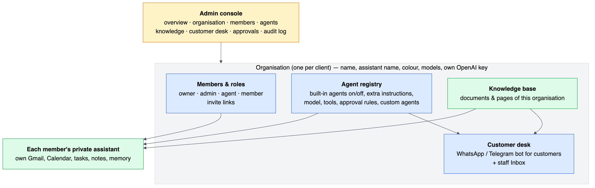
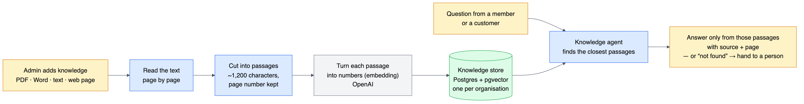
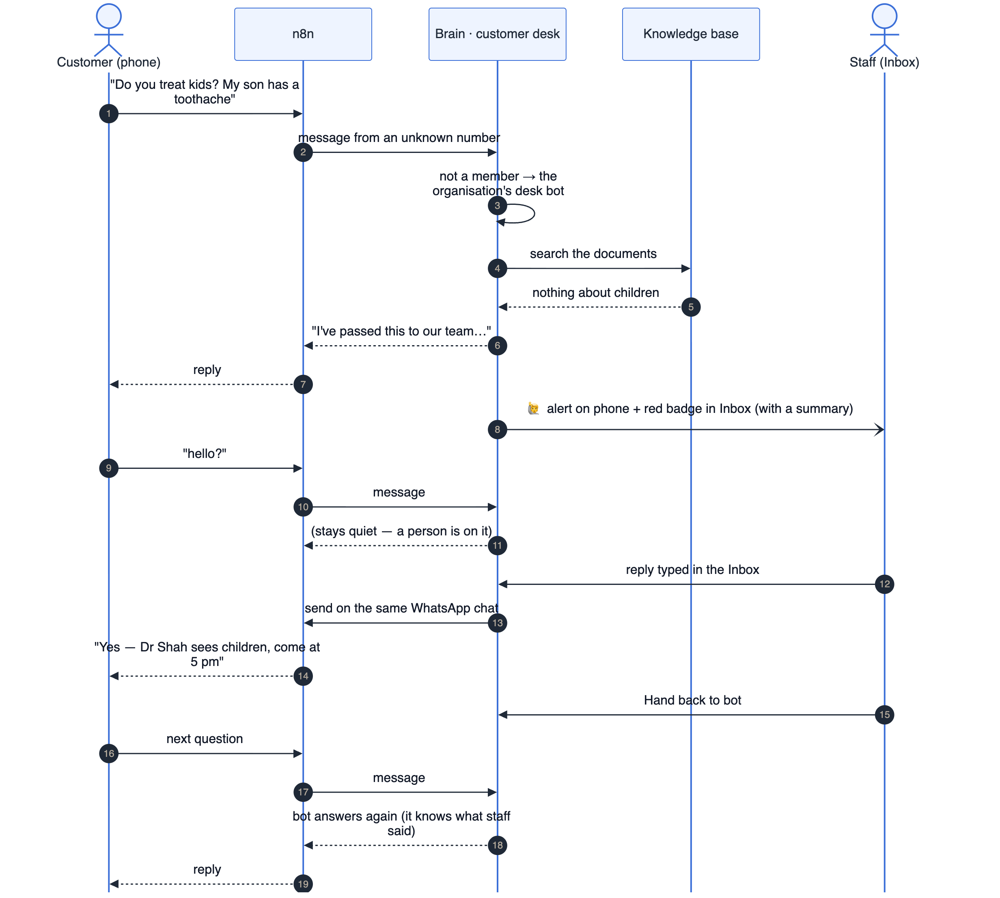

# SwarmAI platform — organisations, agents, knowledge, customer desk, admin console

These are the Phase 1 platform features from [EXPANSION-PLAN.md](EXPANSION-PLAN.md): **P1** multi-tenancy, **P3**
config-driven agents, **P6** knowledge base, **P7** human handoff and inbox, and **P10** the admin console. Together
they turn SwarmAI from one person's assistant into something you can set up for a client in an afternoon.

---

## 1. Organisations and roles (P1)

- **Every user belongs to one organisation.** Signing up without an invitation creates a new organisation with you as
  its **owner**; the sign-up form has an optional *Organisation* field. Accounts that existed before this change were
  each given their own organisation automatically ("Priyam's workspace").
- **Roles**

  | Role | Can |
  |---|---|
  | owner | everything, including making other owners; an organisation always keeps at least one owner |
  | admin | admin console + customer inbox |
  | agent | customer inbox (human staff who answer customers) |
  | member | their own private assistant only |

- **Invitations:** Admin → Members → *Create link*. Each link works once and expires after 7 days; it can be locked
  to one email address. The person opens `…/signup?invite=CODE` and joins with that role.
- **Invite-only sign-up:** with `SIGNUP_MODE=invite` in `brain/.env` (set automatically for servers by
  `./setup.sh server-env`), accounts can only be created from an invitation — except the very first account, so a
  fresh install can create its owner. Unknown values fail closed to `invite`. `GET /api/auth/signup-policy` tells the
  sign-up page which mode is active. Invitation links are claimed atomically, so one link can't create two accounts.
- **Removing a member** moves them into a fresh personal workspace; their own data (mail, tasks, notes) stays with them.
- **Per-organisation settings:** name, **assistant name** (shown in the app header and to customers), **accent colour**,
  timezone, main and fast **models**, and an optional **own OpenAI key**. The key is stored encrypted (AES-256-GCM)
  and is never returned by the API. With a key set, that organisation's chat, knowledge embeddings and desk summaries
  are billed to its own OpenAI account.
- **What is scoped how:**
  - Personal data — Gmail, Calendar, tasks, expenses, notes, memory, reminders — stays scoped to each **user**.
  - Shared data — knowledge base, agent registry, customer conversations, invitations — is scoped to the
    **organisation**.
  - Admin views (approvals, audit log, usage) join members through `users.orgId`.

## 2. Config-driven agents (P3)

The 11 built-in agents (the 10 from before plus the new **Knowledge** agent) are still defined in code
(`brain/src/agents/agents.ts`). On top of that, each organisation has its own **agent registry**
(`agent_configs` table), edited in **Admin → Agents**:

| Setting | Effect |
|---|---|
| on / off | The master agent stops seeing a disabled agent |
| Extra instructions | Appended to the prompt; the safe way to tune a built-in agent ("always reply in Hindi") |
| Replace prompt | Advanced: replaces the built-in prompt |
| Model | Per-agent model; blank uses the organisation's default |
| Tools | Any tools from the **catalogue**: the 47 tools of all built-in agents |
| Approval | Tick a tool so it must be approved before it runs. It then becomes a proposal like "send email"; approval happens on the web card or with YES/NO, and only then does the real tool run. |
| Who can use it | *Members only*, *Customers only (desk)* or *Both* |

- **Custom agents:** pick an id, a name, a description (this is how the master agent decides when to use it), a
  prompt and tools.
- **Safety in code:** customer-facing runs only ever receive tools from a fixed **customer-safe** list
  (`kb_search`, `web_search`, `read_url`, `get_weather`…). Even if an admin ticks `gmail_search` for a customer agent,
  customers can never reach a member's mailbox.
- **Changes** reach everyone in the organisation within about 30 seconds (cached).
- **Industry packs** are JSON files in `brain/packs/`; Admin → Organisation → *Apply* loads one. A pack is a bundle
  of agent configuration plus customer-desk settings. Two are included:
  - `support-desk`: WhatsApp support desk with an *Order help* custom agent.
  - `clinic-front-desk`: clinic FAQ bot that never gives medical advice, plus an *Appointments* agent.

  To add a pack, drop another JSON file into that folder.

## 3. Knowledge base (P6)

- **Admin → Knowledge** accepts:
  - **files**: PDF, Word `.docx`, text, Markdown, CSV, HTML, JSON; up to 15 MB each, uploaded several at a time.
  - **web pages or PDF links**: re-sync with one click.
  - **pasted text**: FAQs, timings, price lists.
- **How it works:**
  1. Text is extracted page by page: `unpdf` for PDFs, `mammoth` for Word.
  2. The text is cut into overlapping passages of about 1,200 characters that never cross a page, so every answer can
     cite a page.
  3. Each passage is embedded with OpenAI `text-embedding-3-small` and stored in `kb_chunks` (pgvector, HNSW index),
     scoped to the organisation.
- **The Knowledge agent** (`kb_search`, `kb_list_sources`) answers only from the passages it finds and cites them as
  *[source, p. N]*. If the answer isn't there it says so, and never guesses. It appears for members once the
  organisation has at least one ready source.
- **Test a question** in Admin → Knowledge shows which passages the agent would get and their match score.
- **Limits:**
  - Scanned PDFs (images only) need OCR first.
  - Google Drive folders and scheduled re-sync are not built yet (planned).
  - About 2 million characters per source.

## 4. Customer desk and human handoff (P7)

**Who reaches what.** When the desk is on (Admin → Customer desk):
- People who message the WhatsApp number or Telegram bot **without being linked members** talk to the
  organisation's customer assistant.
- Members who linked their phone in Settings still reach their own private assistant.
- With the desk off, unknown senders get the old "link your account" message.

**What the bot does:**
- answers from the knowledge base in the customer's language, using the organisation's *About your business* text;
- never invents prices, policies or services, and never infers them ("likely…");
- greets new customers with your greeting.

**When it hands over:**
- the customer asks for a person: "talk to a human", "agent", "kisi se baat karni hai"… (caught instantly, no AI
  call);
- the customer is upset, or needs something only staff can do (refunds, cancellations, bookings, payments);
- the answer isn't in the knowledge base (switch: *Hand over when the answer isn't in the knowledge base*);
- the bot hits an error.

**Then:**
1. The customer gets your hand-over message.
2. The conversation turns **Waiting** with a short AI summary.
3. Every owner, admin and agent gets an alert on their notify channel, e.g. *"🙋 Neha (whatsapp) needs a person…"*
   with a link to the conversation. A red badge shows on **Inbox**.
4. While a person handles it, the **bot stays silent**. n8n skips the reply when the brain returns an empty one.

**The Inbox** (owners, admins, agents):
- filters: *Needs a person*, *Waiting*, *With team*, *With bot*, *Closed*;
- transcript with customer, bot, staff and system lines;
- **Take over**, then reply. The reply goes out on the customer's own WhatsApp/Telegram chat through n8n's MCP send
  tools.
- **Hand back to bot**: the bot resumes and is told what the staff member said, so it doesn't repeat or contradict
  them.
- **Close**: the conversation reopens with the bot when the customer writes again.

Every staff reply, take-over, hand-back and close goes into the audit log.

**Test without WhatsApp:** Admin → Customer desk → *Test as a customer* chats with the bot exactly as a customer
would, even with the desk switched off. The test conversation also appears in the Inbox, so you can practise the full
handoff.

**Several organisations on one server:** set *WhatsApp phone number ID* per organisation. The WhatsApp workflow now
sends the receiving `phone_number_id`, and the brain routes to the matching organisation's desk. Telegram has one bot
per server, so only one organisation should enable the desk for Telegram.

> After updating, run `./setup.sh n8n` once. It re-imports the channel workflows with the new *Has reply?* step and
> the receiving number.

## 5. Admin console (P10)

`/admin`, for owners and admins:

| Tab | What |
|---|---|
| Overview | members, knowledge size, waiting customers, conversations, actions per agent (30 days), set-up checklist |
| Organisation | name, assistant name, colour, timezone, models, own OpenAI key, **industry packs** |
| Members | roles, remove, invitation links |
| Agents | registry editor (above), custom agents |
| Knowledge | upload, add web pages, paste text, re-sync, delete, test a question |
| Customer desk | on/off, channels, business instructions, greeting, hand-over message, WhatsApp number id, **simulator** |
| Approvals | members' actions still waiting for approval (read-only — the member who asked approves) |
| Audit log | every logged action of every member, searchable |

All of it is also in Swagger (`/api/docs`) under *Admin console* and *Customer desk*.

## 6. API summary

| Area | Endpoints |
|---|---|
| Auth | `POST /api/auth/signup` (`invite`, `orgName`), `GET /api/auth/invite/:code`, `GET /api/me` (now includes `org`, `role`) |
| Admin (owner/admin) | `GET/PATCH /api/admin/org`, `GET /api/admin/usage`, `GET /api/admin/approvals`, `GET /api/admin/audit`, `GET /api/admin/members`, `PATCH/DELETE /api/admin/members/:id`, `GET/POST /api/admin/invites`, `DELETE /api/admin/invites/:code` |
| Agents | `GET /api/admin/agents`, `PUT /api/admin/agents/:id`, `POST /api/admin/agents`, `DELETE /api/admin/agents/:id`, `GET /api/admin/packs`, `POST /api/admin/packs/:id/apply` |
| Knowledge | `GET /api/admin/knowledge`, `POST …/file`, `POST …/url`, `POST …/text`, `POST …/search`, `POST …/:id/resync`, `GET …/:id/preview`, `DELETE …/:id` |
| Desk (owner/admin/agent) | `GET /api/desk/conversations?status=`, `GET /api/desk/counts`, `GET /api/desk/conversations/:id`, `POST …/:id/reply`, `POST …/:id/assign`, `POST …/:id/release`, `POST …/:id/close`, simulator `GET/POST/DELETE /api/desk/simulate` |

## 7. New code at a glance

| Path | Purpose |
|---|---|
| `brain/src/orgs/org.service.ts` | organisations, roles, invites, settings and key, approvals, audit, usage, migration of old accounts |
| `brain/src/agents/registry.service.ts` | tool catalogue, per-org merge, customer-safe filter, approval wrapper, packs |
| `brain/src/knowledge/` | `chunk.ts` (page-aware chunker), `knowledge.service.ts` (ingest, pgvector search) |
| `brain/src/agents/tools/knowledge-tools.ts` | `kb_search`, `kb_list_sources` |
| `brain/src/desk/` | `desk.service.ts` (customer runs, escalation, inbox actions, simulator), `desk.controller.ts` |
| `brain/src/admin/admin.controller.ts` | admin console API |
| `brain/packs/*.json` | industry packs |
| `web/src/components/admin/*` | admin console tabs |
| `web/src/components/InboxView.tsx` | staff inbox |

Tests: 41 unit tests (`cd brain && pnpm test`). New ones cover the chunker, "wants a human" detection, invite-only sign-up, the registry
merge, customer-safe tool filtering and approval-wrapped tools.
