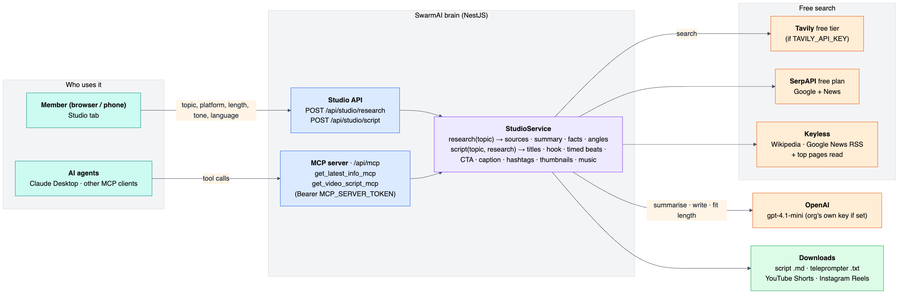

# Studio — StoryForge, the YouTube content creation agent

The **Studio** tab turns a topic into a ready-to-shoot short-form video script in about 10–15 seconds: it researches
the topic in real time, summarises what's new, suggests angles, and writes a timed script for **YouTube Shorts** and
**Instagram Reels** that you can copy or download. The same two steps are available to AI agents such as Claude
Desktop through an **MCP server**.



## What it does
| Step | Result |
|---|---|
| **1. Research** | Up to 10 fresh sources (news first, then the web), the top pages read for detail, and an OpenAI summary: overview, 5–8 key facts each linked to its source, 3–5 video angles, and how recent the information is. Facts come only from the sources. |
| **2. Script** | 3 title options, a scroll-stopping hook (first 3 s), 4–8 timed beats with voice-over, on-screen text and visual direction, a CTA, the post caption, hashtags, thumbnail ideas and a music mood — in the chosen language and tone. |
| **Length control** | ~2.5 spoken words per second (30 s ≈ 75 words, 60 s ≈ 150). If the first draft is more than 15 % over or 20 % under, it is rewritten once to fit. |
| **Export** | *Copy all*, **Script (.md)** (everything, with sources) and **Teleprompter (.txt)** (only what you say). The last 8 scripts stay under *Recent scripts* on that device. |

Options: platform (Shorts · Reels · both), length (30 · 45 · 60 · 90 s), tone (energetic · informative · storytelling ·
funny · inspirational), language (English, Hindi, Hinglish, Tamil, Telugu, Marathi, Bengali, Spanish), optional angle
(click one from the research) and audience.

## Free sources only
| Order | Source | Needs |
|---|---|---|
| 1 | **Tavily** (free tier, 1,000 credits/month): news from the last 30 days + web, in parallel — 2 credits per research (~500 researches/month) | `TAVILY_API_KEY` in `brain/.env` (optional) |
| 2 | **SerpAPI** Google + Google News (free plan, 250 searches/month) | `SERPAPI_KEY` (already used by the Research agent) |
| 3 | **Wikipedia + Google News RSS** | nothing (keyless fallback) |
| + | Top 3 pages read for detail | nothing |

The language model is **OpenAI** (`OPENAI_MODEL_FAST`, default `gpt-4.1-mini`). An organisation with its own OpenAI
key (Admin → Organisation) is billed to that key; MCP calls use the server's key. One research + script run costs
roughly ₹1–2.

## API (signed-in users)
| Endpoint | Body | Returns |
|---|---|---|
| `GET /api/studio/options` | — | platforms, lengths, tones, active search provider |
| `POST /api/studio/research` | `{ topic }` | `{ summary, keyFacts[], angles[], freshness, sources[], provider }` |
| `POST /api/studio/script` | `{ topic, research?, angle?, platform, durationSec, tone, language, audience?, sources? }` — without `research` it researches first | `{ script, markdown, teleprompter }` |

Swagger: `/api/docs` → *Studio (StoryForge)*.

## MCP server (for Claude Desktop and other agents)
Streamable HTTP at **`https://<domain>/api/mcp`**, enabled when `MCP_SERVER_TOKEN` is set (`./setup.sh server-env`
generates one for servers). Every request needs `Authorization: Bearer <MCP_SERVER_TOKEN>`.

| Tool | Input | Output |
|---|---|---|
| `get_latest_info_mcp` | `topic` | research as text: summary, key facts with source numbers, sources |
| `get_video_script_mcp` | `topic`, optional `info_text` (e.g. the output above), `platform`, `duration_seconds`, `tone`, `language` | the full script as Markdown |

**Claude Desktop** (`claude_desktop_config.json`, via the `mcp-remote` bridge; needs Node.js):
```json
{
  "mcpServers": {
    "storyforge": {
      "command": "npx",
      "args": ["-y", "mcp-remote", "https://<domain>/api/mcp", "--header", "Authorization:Bearer ${MCP_TOKEN}"],
      "env": { "MCP_TOKEN": "<MCP_SERVER_TOKEN>" }
    }
  }
}
```
Restart Claude Desktop, then ask e.g. *"Use storyforge to research the latest on Chandrayaan-4 and write a 45-second
Reels script in Hinglish."* Admins see the same snippet, with the right address, at the bottom of the Studio tab.

## Code
| Path | What |
|---|---|
| `brain/src/studio/studio.service.ts` | search (Tavily → SerpAPI → keyless), page reading, research and script prompts, length correction, Markdown / teleprompter export |
| `brain/src/studio/studio.controller.ts` | `/api/studio/*` for signed-in users (organisation's model and key) |
| `brain/src/studio/mcp.controller.ts` | `/api/mcp` — `@modelcontextprotocol/server` (`createMcpHandler`, stateless) behind a constant-time bearer check |
| `web/src/components/StudioView.tsx` | the Studio tab (dark studio theme), downloads, local history, MCP panel for admins |
| `brain/src/studio/studio.spec.ts` | word budget, export formats, input validation, source de-duplication, MCP token check |

Compared with the original StoryForge design (Streamlit + Gemini + Tavily): the UI is a tab inside SwarmAI (same
login, roles and HTTPS server), the model is OpenAI, and search uses only free tiers with a keyless fallback.
